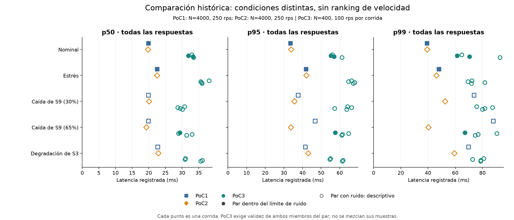
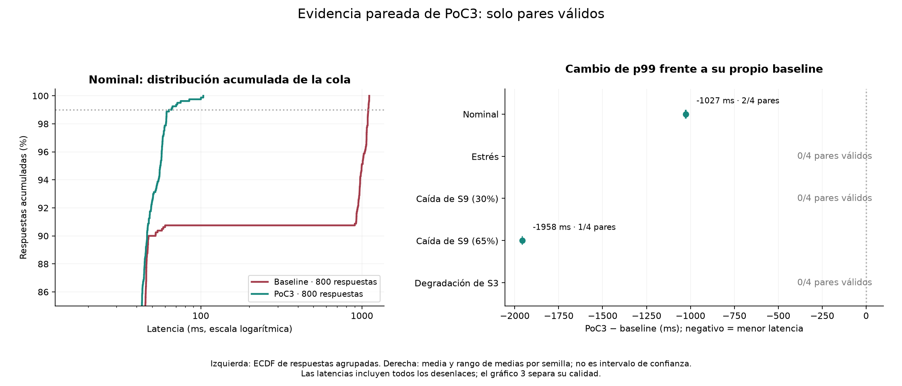
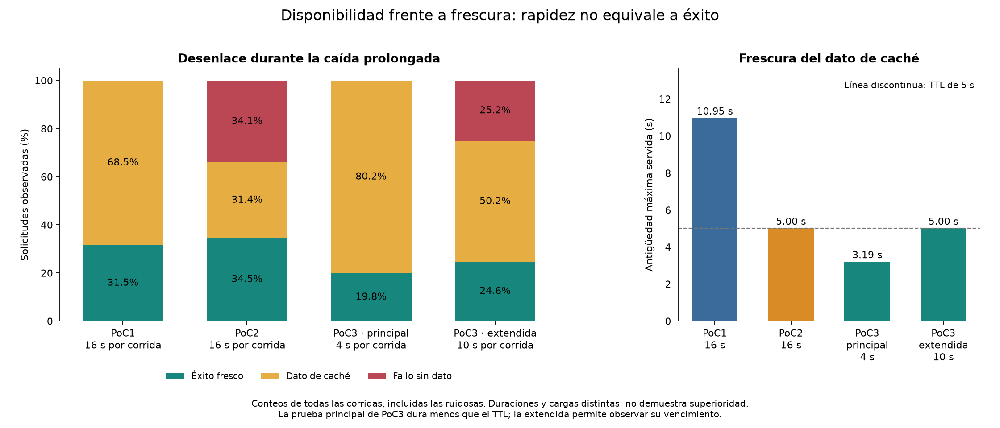

# Saved-result comparison

Historical comparison; not a controlled ranking between versions.

| Version | Role |
|---|---|
| PoC1 | Fixed calibrated thresholds; cache without a maximum age. |
| PoC2 | Adaptive thresholds, bounded-age cache, guarded recovery and retry controls. |
| PoC3 | PoC2 policy with corrected failures, paired samples, transparent calibration and measurement quality. |

## 1. Historical latencies

Each point is a saved run. Hollow markers identify noisy pairs; PoC3 requires both members to be valid. PoC1: N=4000, 250 rps; PoC2: N=4000, 250 rps. PoC3: N=400, 100 rps per run. Different workloads, seeds and measurement methods prevent attributing cross-version differences to the policy alone.

Saved nominal p99: PoC1: 39.2 ms; PoC2: 39.4 ms. Single historical runs do not establish a winner.

## 2. PoC3 against its own baseline

Nominal valid pairs: 2/4. Mean of seed-level p99 values: baseline 1092.7 ms; PoC3 65.9 ms. This supports a reduction against its own baseline, not superiority to PoC2.

The ECDF pools only accepted records. The difference chart uses seed means and their observed range, not confidence intervals. Scenarios without clean pairs have no performance estimate.

## 3. Outcomes and freshness

PoC1 keeps responding with older cache. PoC2/3 stop serving cache after 5 seconds and can fail instead. Failure rates also depend on the duration of the outage, not only on the architecture.

Zero failures in PoC3's short run do not prove higher availability: that run does not exhaust the TTL.

In PoC3's extended validation, 25.17% failed and the oldest served cache was 5.00 s. These counts include noisy runs; compare the policy trade-off, not a causal improvement percentage.

PoC3's demonstrated contribution is correctness and more trustworthy evaluation. It preserves PoC2's adaptive policy; lower latency than PoC2 has not been demonstrated.

Regenerate: `python -B run.py plot` (matplotlib required). Sources and SHA-256 hashes: `plots/sources.json`.
