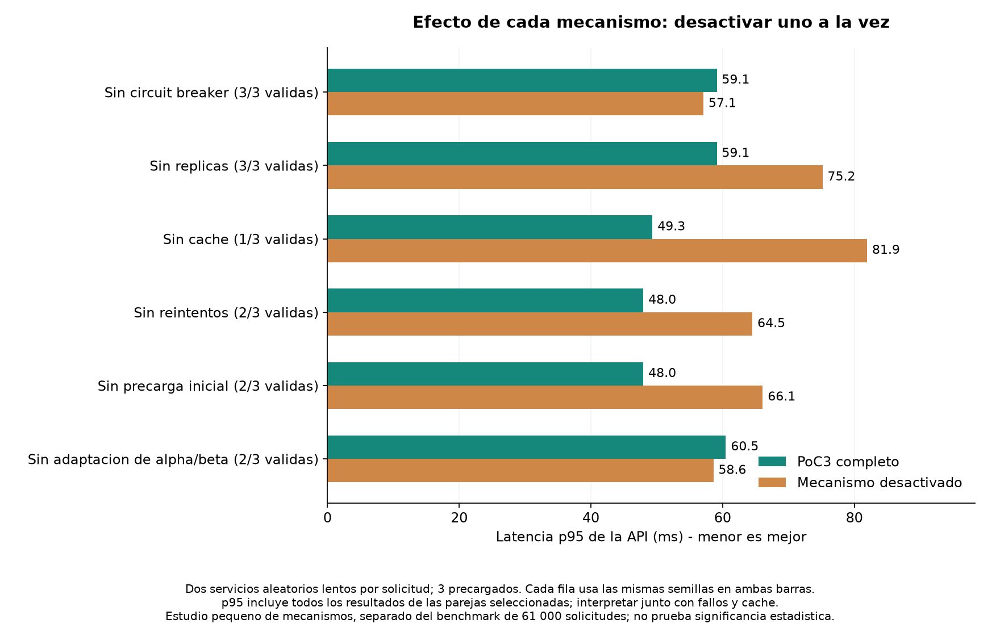
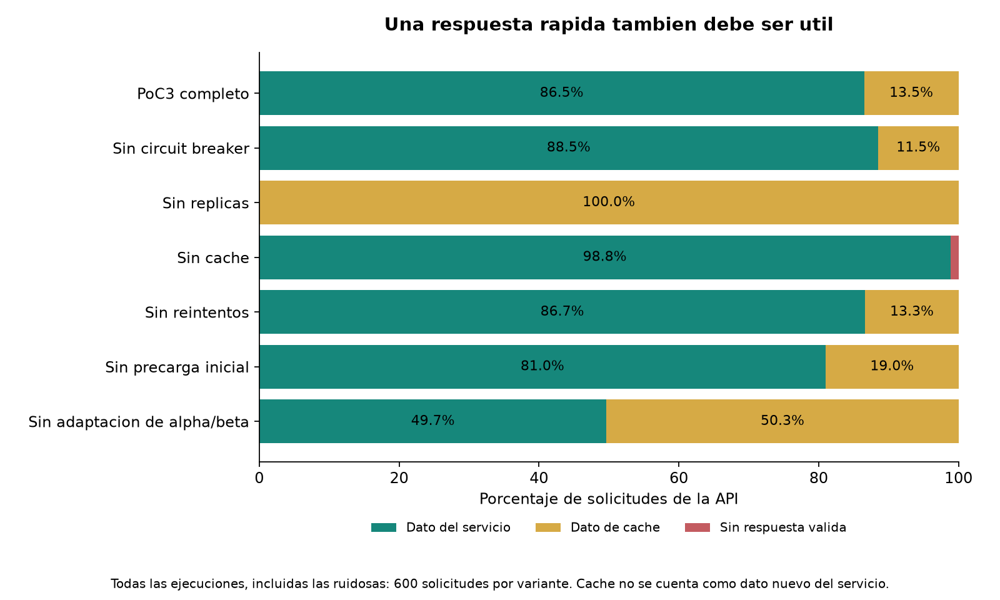
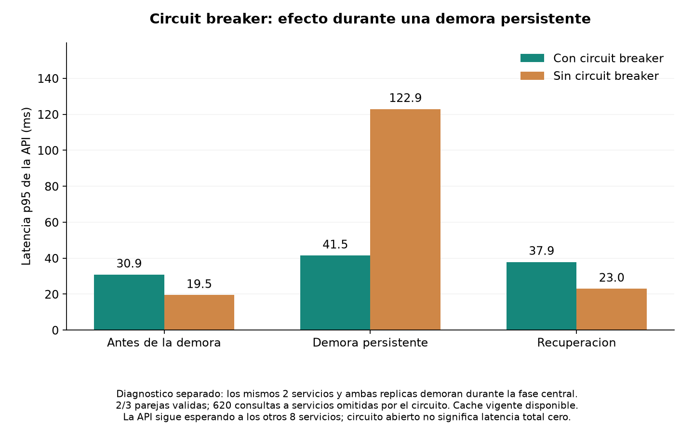

# Mechanism measurements

Separate diagnostic study: 5460 API requests; three seeds, 50 requests/s. The official 61000-request results are unchanged. This small study does not establish statistical significance.

Each disabled component is compared with the full policy using identical primary samples and the same eligible seeds. If no clean pairs exist, values are noisy observations. Response outcomes retain every run.

| Mechanism disabled | Full p95 ms | Disabled p95 ms | Clean pairs |
|---|---:|---:|---:|
| no_breaker | 59.11 | 57.09 | 3/3 |
| no_hedging | 59.11 | 75.17 | 3/3 |
| no_cache | 49.35 | 81.93 | 1/3 |
| no_retries | 47.96 | 64.52 | 2/3 |
| no_preload | 47.96 | 66.09 | 2/3 |
| fixed_thresholds | 60.49 | 58.60 | 2/3 |

| Variant | Requests (all runs) | Service response | Cached response | Failed |
|---|---:|---:|---:|---:|
| full | 600 | 519 | 81 | 0 |
| no_breaker | 600 | 531 | 69 | 0 |
| no_hedging | 600 | 0 | 600 | 0 |
| no_cache | 600 | 593 | 0 | 7 |
| no_retries | 600 | 520 | 80 | 0 |
| no_preload | 600 | 486 | 114 | 0 |
| fixed_thresholds | 600 | 298 | 302 | 0 |

Circuit breaker: 0 skipped service calls in the full ordinary workload; when it does not activate, latency differences against its disabled variant are execution variation, not demonstrated savings. The separate persistent-delay scenario skipped 620 service calls in eligible pairs and recorded 6 successful half-open-to-closed transitions across all seeds.

The state diagram uses a single measured example (seed 101, service 9): first opening at 0.32 s, first recovery probe at 1.34 s, successful closing at 3.43 s; 153 calls omitted. The grouping of services in sequence diagrams is visual: each service still has its own breaker.

Persistent-delay API p95: 41.45 ms with breaker versus 122.93 ms without. For 432 matching service calls rejected at entry, median service latency was 0.023 versus 35.612 ms. These are conditional service timings, not whole-API timings or a guarantee for every outage.

| Mechanism | Observation and interpretation |
|---|---|
| Hedging / replicas | Compare no_hedging with full AND the cache percentage: low latency can come from cached fallback rather than fresh service responses. |
| Cache / TTL | Compare no_cache; every cache hit records age and fresh/stale tier. Expired data is not served. |
| Three-service preload | Compare no_preload: only initial cached entries are removed; successful calls can still populate caches. The effect is mainly startup-dependent. |
| Retries / backoff / budget | Compare no_retries as a combined retry policy. Attempt events record elapsed times and budget decisions; this does not isolate backoff or budget individually. |
| Adaptive alpha/beta | Compare fixed_thresholds with full; 200 requests per repetition are a short learning window, not proof that fixed values are better in general. |
| Parallel fan-out / cancellation | The diagram groups two slow services and eight others. API latency follows the last required result, and pending work is cancelled; timings are not added across parallel calls. |

Observed full-policy thresholds in the ordinary workload: alpha 17.00–27.88 ms; beta 34.10–55.93 ms. Maximum cache age served: 0.061 s.

Raw per-request/per-service records, circuit decisions, cache ages, retries and cancellation events are retained in results.json.

