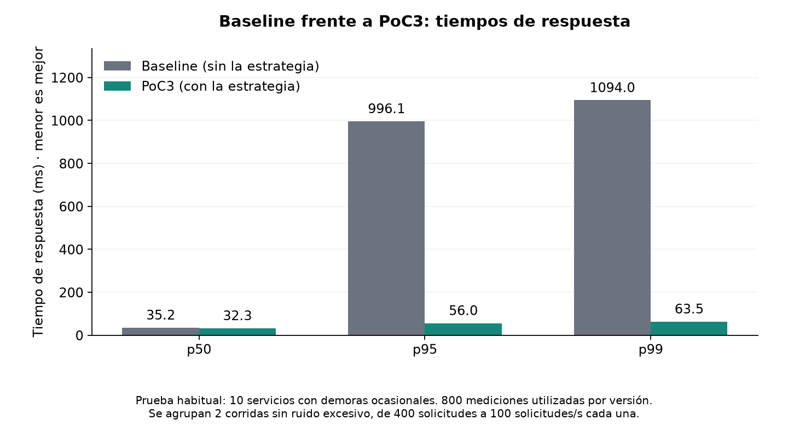
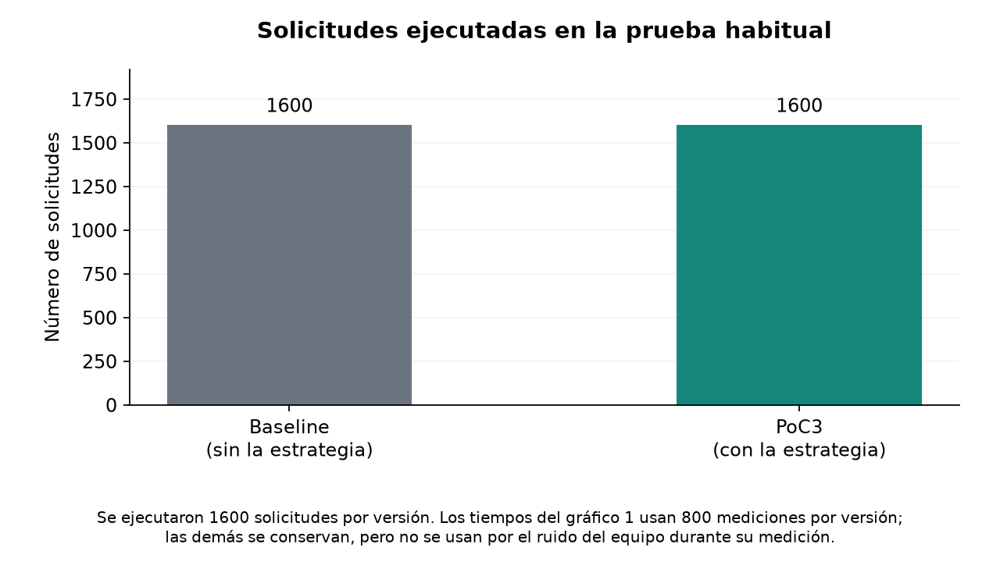

# Lab presentation

Baseline: parallel calls without the proposed strategy. PoC3: the same simulation with the strategy enabled.

| Required measure | Baseline | PoC3 |
|---|---:|---:|
| p50 (ms) | 35.2 | 32.3 |
| p95 (ms) | 996.1 | 56.0 |
| p99 (ms) | 1094.0 | 63.5 |
| Requests executed | 1600 | 1600 |

Latency percentiles pool 800 usable measurements per version. All 1600 executed requests per version remain recorded; measurements affected by excessive machine noise are excluded from latency calculations. These pooled percentiles differ slightly from the advanced report's mean of per-seed percentiles.

p50/p95/p99: time within which 50%/95%/99% of requests finish. A lower p99 means shorter waits for the slowest part of the experience.

Failed responses among the latency samples: baseline 0; PoC3 0. Cached responses in PoC3: 1.

## What the five scenarios test

| Scenario | What changes | What it checks |
|---|---|---|
| Usual case (`tails`) | Ten services, each with 1% slow calls around one second; otherwise typically 10 ms. | Reduction of occasional long waits; the core lab demonstration. |
| Stress (`tails_heavy`) | Services 8–10 have 10% slow calls; slow delays range from 0.5 to 1.5 s. | Behavior when slow responses become more frequent. |
| Short S9 outage (`outage_svc9`) | Both S9 replicas take 2 s during the middle 30% of the workload. | Breaker, fallback and recovery during a temporary problem. |
| Longer S9 outage (`outage_long_svc9`) | The same problem lasts for 65% of the workload. | Behavior as cached data ages. The workload must last long enough to exceed the 5 s cache TTL. |
| S3 degradation (`drift_svc3`) | S3's typical latency becomes 2.5 times larger during 40% of the workload. | Whether adaptive thresholds respond to a slower service without a complete outage. |

The lab requires a baseline/proposal comparison; it does not require all five scenarios. The other scenarios add resilience evidence. Unit tests check code correctness and are different from these performance scenarios.

PoC1 uses fixed thresholds and unbounded-age cache; PoC2 adds adaptive thresholds and freshness controls; PoC3 keeps PoC2's policy and corrects error handling and measurement. Historical PoC1/2 runs use different workloads, so this presentation does not rank the versions.

Decision: GO WITH CHANGES. The saved usual-case comparison supports tail reduction; remaining noisy scenarios do not support firm performance conclusions.
