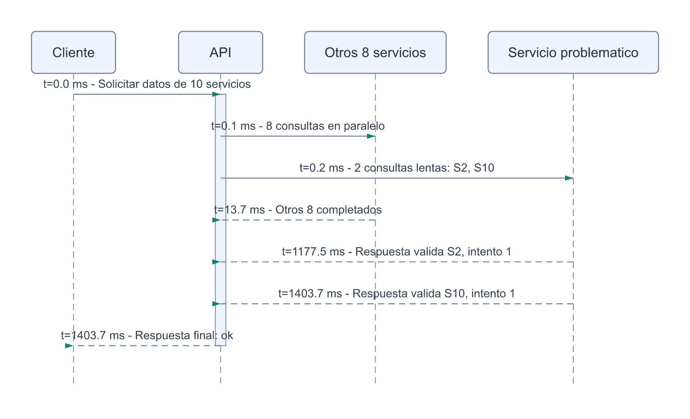
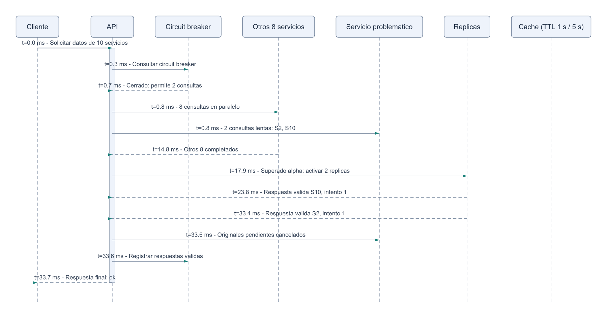
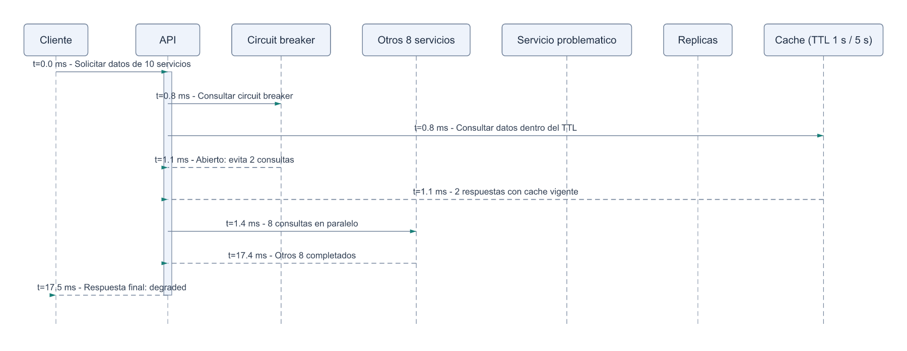

# Measured request sequence

Three measured demonstration requests plus six setup requests, separate from the 61000 benchmark requests. Times are elapsed wall-clock milliseconds from one example, not p50/p95/p99. Vertical spacing shows message order, not proportional elapsed time. The other eight services and retry sends are grouped; all events remain in trace.json.

| Variant | Slow services | Response time ms | Outcome |
|---|---|---:|---|
| baseline | (2, 10) | 1403.7 | ok |
| poc3 | (2, 10) | 33.7 | ok |
| breaker_open | (4, 8) | 17.5 | degraded |

The single Servicio problematico block groups the two slow services; both remain in the simulation. breaker_open is a separate persistent-delay example: one healthy request fills caches, then five fault requests open both circuits. The API still waits for the other eight services. Circuit-open service latency is not the whole API latency.

PoC3 initially preloads cache for services [2, 5, 6], independently of slow services. All ten services can subsequently refresh cached data. Cache is a fallback after an unsuccessful attempt. PoC3 starts with alpha=17 ms and beta=34.1 ms. A replica is another instance of the same service; it may answer faster. Pending original calls are cancelled when an attempt finishes or reaches its timeout. Both replicas being slow is still possible; the trace shows the actual outcome.

