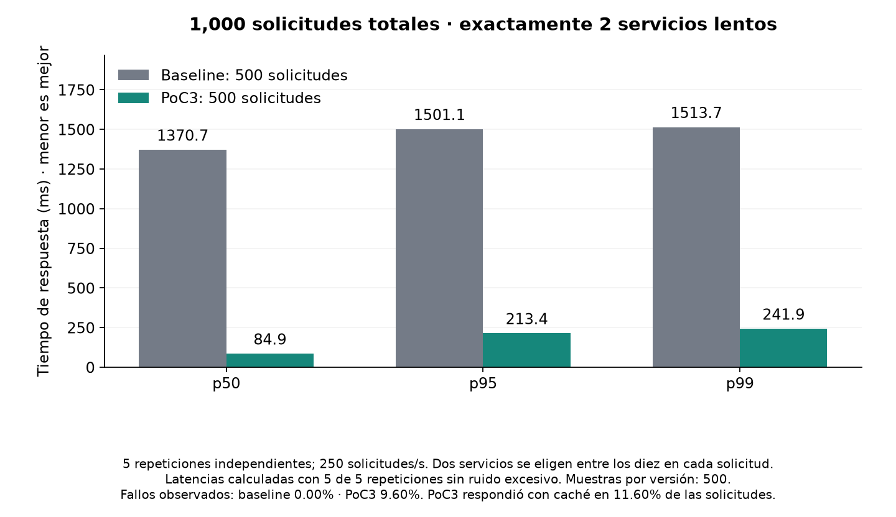
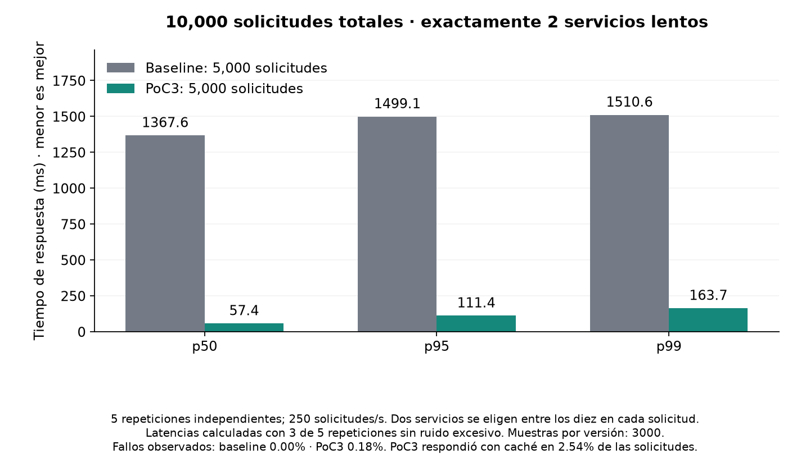
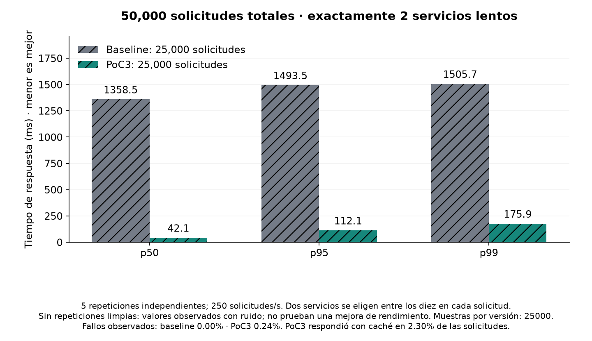

# Two-slow-service benchmark

Exactly two random primary services per request take 1000–1500 ms. The other eight are fast. Independent replicas retain a 1% slow-call probability; hedging can therefore find a faster answer. This is a model assumption, not a guarantee for real shared failures.

Totals include both variants and all five repetitions: 500/500, 5000/5000 and 25000/25000. The three levels total 61000 API requests. Backend fan-out/hedge calls are counted separately.

| Total | Variant | p50 ms | p95 ms | p99 ms | Executed | Failed % (all runs) | Extra backend load % |
|---|---|---:|---:|---:|---:|---:|---:|
| 1000 | baseline | 1370.7 | 1501.1 | 1513.7 | 500 | 0.00 | 0.00 |
| 1000 | poc3 | 84.9 | 213.4 | 241.9 | 500 | 9.60 | 35.14 |
| 10000 | baseline | 1367.6 | 1499.1 | 1510.6 | 5000 | 0.00 | 0.00 |
| 10000 | poc3 | 57.4 | 111.4 | 163.7 | 5000 | 0.18 | 22.31 |
| 50000 | baseline | 1358.5 | 1493.5 | 1505.7 | 25000 | 0.00 | 0.00 |
| 50000 | poc3 | 42.1 | 112.1 | 175.9 | 25000 | 0.24 | 22.18 |

Latency uses complete clean pairs where available; otherwise hatched bars are descriptive noisy observations only. Raw repetitions, source fingerprints and measurement quality remain in each level JSON. Different total counts test sample-size stability at a fixed arrival rate; they are not a test of increasing RPS capacity.

Five independent seeds supply repetition; a larger request count alone does not establish statistical significance. The per-seed p99 range and outcomes are retained in the manifest; no confidence or significance claim is made. Each repetition starts a fresh adaptive controller: short runs expose startup learning, while longer runs include more time after adaptation. Lower latency does not compensate for failed responses; interpret the failure percentage printed on each chart.

PoC1 has fixed thresholds; PoC2 adds adaptation and freshness controls; PoC3 retains that policy with corrected failures and measurement. Old PoC1/2 experiments did not force exactly two slow primaries and cannot be ranked against this new benchmark.

Windows timer resolution is requested only during this benchmark and released afterward; see [Microsoft documentation](https://learn.microsoft.com/en-us/windows/win32/api/timeapi/nf-timeapi-timebeginperiod). The 20 ms lag limit remains unchanged.
