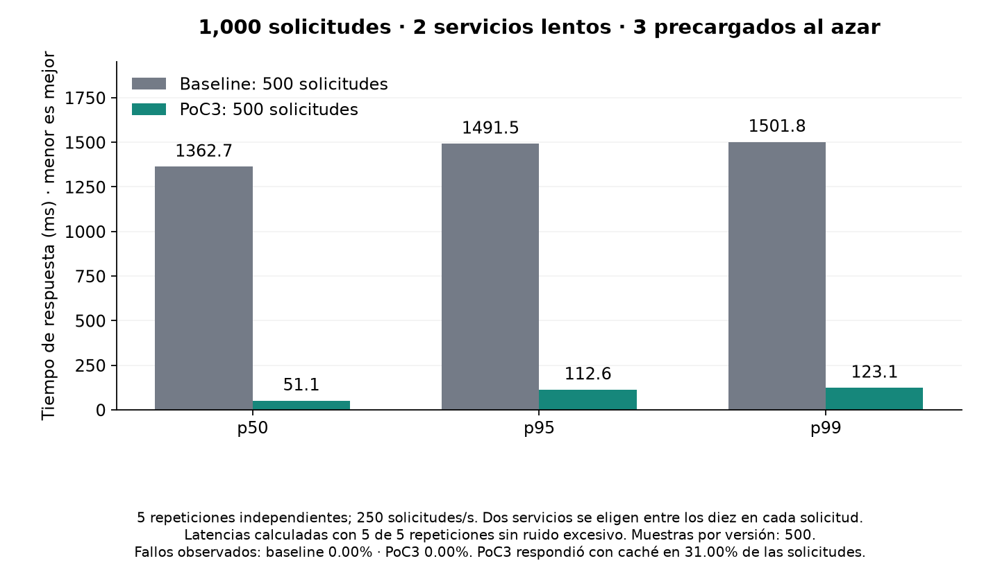
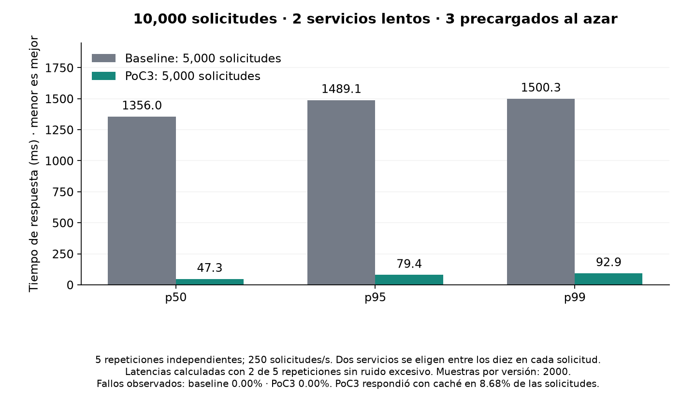
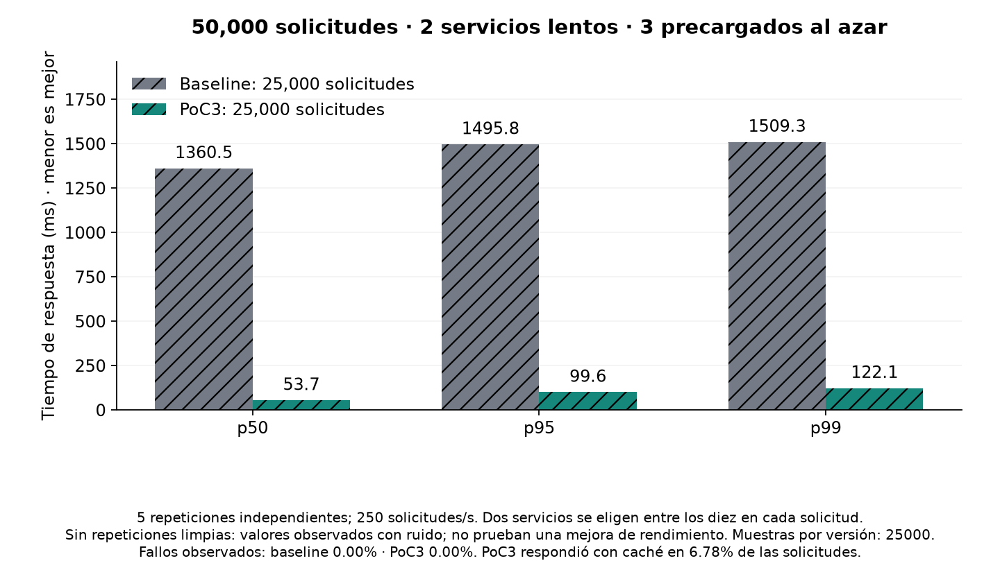

# Two-slow-service benchmark

Exactly two random primary services per request take 1000–1500 ms. The other eight are fast. Independent replicas retain a 1% slow-call probability; hedging can therefore find a faster answer. This is a model assumption, not a guarantee for real shared failures.

PoC3 starts each repetition with cached data for exactly three randomly selected services. Selection uses a separate seeded stream and does not depend on the two slow services. All ten services can refresh their cache after success; existing 1 s fresh/5 s maximum TTLs apply. Cache is a fallback after an unsuccessful attempt, not an unconditional immediate answer. Baseline has no cache. This preloaded state is simulated; no extra warm-up requests are generated.

Totals include both variants and all five repetitions: 500/500, 5000/5000 and 25000/25000. The three levels total 61000 API requests. Backend fan-out/hedge calls are counted separately.

| Total | Variant | p50 ms | p95 ms | p99 ms | Executed | Failed % (all runs) | Extra backend load % |
|---|---|---:|---:|---:|---:|---:|---:|
| 1000 | baseline | 1362.7 | 1491.5 | 1501.8 | 500 | 0.00 | 0.00 |
| 1000 | poc3 | 51.1 | 112.6 | 123.1 | 500 | 0.00 | 25.26 |
| 10000 | baseline | 1356.0 | 1489.1 | 1500.3 | 5000 | 0.00 | 0.00 |
| 10000 | poc3 | 47.3 | 79.4 | 92.9 | 5000 | 0.00 | 20.90 |
| 50000 | baseline | 1360.5 | 1495.8 | 1509.3 | 25000 | 0.00 | 0.00 |
| 50000 | poc3 | 53.7 | 99.6 | 122.1 | 25000 | 0.00 | 20.55 |

Latency uses complete clean pairs where available; otherwise hatched bars are descriptive noisy observations only. Raw repetitions, source fingerprints and measurement quality remain in each level JSON. Different total counts test sample-size stability at a fixed arrival rate; they are not a test of increasing RPS capacity.

Five independent seeds supply repetition; a larger request count alone does not establish statistical significance. The per-seed p99 range and outcomes are retained in the manifest; no confidence or significance claim is made. Each repetition starts a fresh adaptive controller: short runs expose startup learning, while longer runs include more time after adaptation. Lower latency does not compensate for failed responses; interpret the failure percentage printed on each chart.

PoC1 has fixed thresholds; PoC2 adds adaptation and freshness controls; PoC3 retains that policy with corrected failures and measurement. Old PoC1/2 experiments did not force exactly two slow primaries and cannot be ranked against this new benchmark.

Windows timer resolution is requested only during this benchmark and released afterward; see [Microsoft documentation](https://learn.microsoft.com/en-us/windows/win32/api/timeapi/nf-timeapi-timebeginperiod). The 20 ms lag limit remains unchanged.
