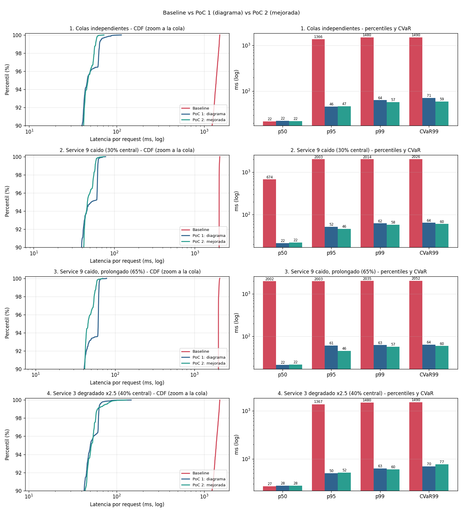

#### 1. Colas independientes

| Metrica | Baseline | PoC 1: diagrama | PoC 2: mejorada |
|---|---:|---:|---:|
| p50 (ms) | 21.9 | 22.5 | 22.2 |
| p95 (ms) | 1366.5 | 46.1 | 46.9 |
| p99 (ms) | 1480.2 | 63.5 | 57.4 |
| CVaR99 (ms) | 1489.9 | 71.4 | 59.2 |
| Requests ejecutadas | 4000 | 4000 | 4000 |
| Llamadas a backend | 40000 | 42137 | 41902 |
| Carga extra | 0.0% | 5.34% | 4.75% |
| Requests degradadas (dato de cache) | 0 (0.0%) | 128 (3.2%) | 131 (3.28%) |
| Requests con llamada fallida (GG) | 0 (0.0%) | 0 (0.0%) | 0 (0.0%) |
| Hedges / retries / timeouts | 0 / 0 / 0 | 2135 / 2 / 130 | 1899 / 3 / 134 |
| Antiguedad max. del dato de cache (s) | - | 0.01 | 0.01 |
| Lag p99 del event loop (ms) | 3.17 | 3.46 | 1.65 |

#### 2. Service 9 caido (30% central)

| Metrica | Baseline | PoC 1: diagrama | PoC 2: mejorada |
|---|---:|---:|---:|
| p50 (ms) | 674.4 | 21.5 | 22.2 |
| p95 (ms) | 2003.2 | 51.9 | 46.4 |
| p99 (ms) | 2014.0 | 62.5 | 58.0 |
| CVaR99 (ms) | 2026.1 | 64.4 | 60.3 |
| Requests ejecutadas | 4000 | 4000 | 4000 |
| Llamadas a backend | 40000 | 40700 | 40474 |
| Carga extra | 0.0% | 1.75% | 1.18% |
| Requests degradadas (dato de cache) | 0 (0.0%) | 1485 (37.12%) | 1332 (33.3%) |
| Requests con llamada fallida (GG) | 0 (0.0%) | 0 (0.0%) | 94 (2.35%) |
| Hedges / retries / timeouts | 0 / 0 / 0 | 2024 / 2 / 195 | 1794 / 4 / 139 |
| Antiguedad max. del dato de cache (s) | - | 5.62 | 5.0 |
| Lag p99 del event loop (ms) | 5.46 | 1.52 | 1.75 |

#### 3. Service 9 caido, prolongado (65%)

| Metrica | Baseline | PoC 1: diagrama | PoC 2: mejorada |
|---|---:|---:|---:|
| p50 (ms) | 2001.5 | 21.6 | 21.9 |
| p95 (ms) | 2003.4 | 61.4 | 45.7 |
| p99 (ms) | 2035.3 | 62.9 | 57.4 |
| CVaR99 (ms) | 2052.3 | 64.3 | 59.7 |
| Requests ejecutadas | 4000 | 4000 | 4000 |
| Llamadas a backend | 40000 | 39293 | 39045 |
| Carga extra | 0.0% | -1.77% | -2.39% |
| Requests degradadas (dato de cache) | 0 (0.0%) | 2845 (71.12%) | 1295 (32.38%) |
| Requests con llamada fallida (GG) | 0 (0.0%) | 0 (0.0%) | 1397 (34.92%) |
| Hedges / retries / timeouts | 0 / 0 / 0 | 1940 / 2 / 261 | 1670 / 3 / 127 |
| Antiguedad max. del dato de cache (s) | - | 11.22 | 5.0 |
| Lag p99 del event loop (ms) | 2.04 | 1.79 | 2.06 |

#### 4. Service 3 degradado x2.5 (40% central)

| Metrica | Baseline | PoC 1: diagrama | PoC 2: mejorada |
|---|---:|---:|---:|
| p50 (ms) | 26.7 | 27.6 | 27.5 |
| p95 (ms) | 1367.2 | 50.3 | 51.6 |
| p99 (ms) | 1480.1 | 63.0 | 60.4 |
| CVaR99 (ms) | 1490.1 | 69.9 | 77.1 |
| Requests ejecutadas | 4000 | 4000 | 4000 |
| Llamadas a backend | 40000 | 43175 | 41955 |
| Carga extra | 0.0% | 7.94% | 4.89% |
| Requests degradadas (dato de cache) | 0 (0.0%) | 128 (3.2%) | 131 (3.28%) |
| Requests con llamada fallida (GG) | 0 (0.0%) | 0 (0.0%) | 0 (0.0%) |
| Hedges / retries / timeouts | 0 / 0 / 0 | 3167 / 8 / 136 | 1949 / 6 / 137 |
| Antiguedad max. del dato de cache (s) | - | 0.01 | 0.01 |
| Lag p99 del event loop (ms) | 1.88 | 2.93 | 2.01 |

