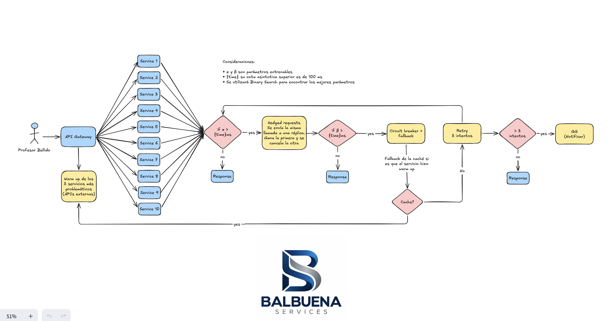
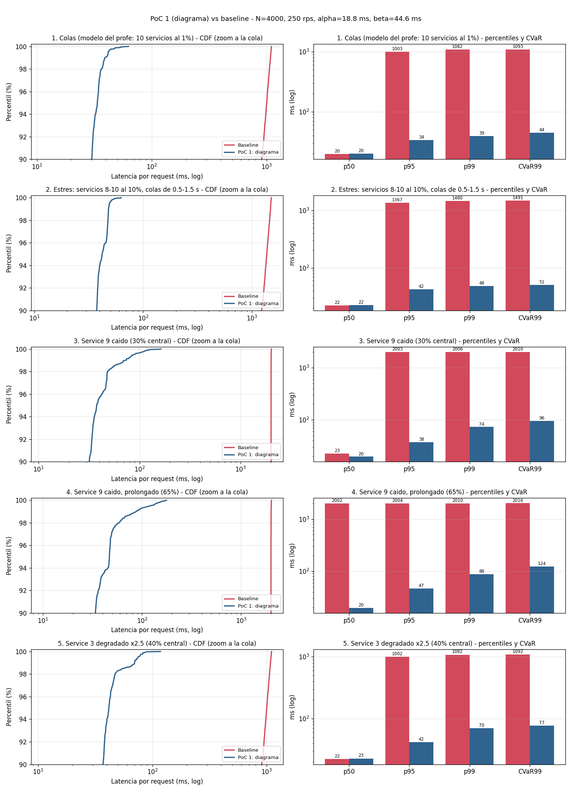

# PoC 1 - Arquitectura tal cual el diagrama

Implementa el diagrama `arquitectura-poc1.png` sin cambios, para medir si la arquitectura propuesta por el equipo reduce la tail latency.



## Qué hace

Por cada llamada a uno de los 10 servicios (el fan-out es paralelo):

1. Al arrancar se hace warm up de los 3 servicios más problemáticos (Service 8, 9 y 10, las APIs externas) y se precarga su caché.
2. Si el servicio no responde en α ms, se envía la misma llamada a una réplica (hedged request). Gana la primera respuesta y se cancela la otra.
3. Si no hay respuesta en β ms entra el circuit breaker con fallback. Si el servicio tiene caché se responde con ese dato. Si no tiene, se reintenta (máximo 3 intentos, vuelve al paso 2).
4. Pasados los 3 intentos se notifica (GG) y la llamada se da por fallida.

El breaker abre tras 5 fallos seguidos y se prueba de nuevo al segundo. La caché solo existe para los servicios con warm up, como dice el diagrama.

## Cómo se entrenaron α y β

Las consideraciones del diagrama piden entrenar α y β con búsqueda binaria, y la foto de la justificación da la función objetivo: CVaR_q(T) = min sobre τ de [ τ + E[(T-τ)+] / (1-q) ] (Rockafellar y Uryasev). Con q = 0.99 es el promedio del 1% peor de las latencias. El mínimo se alcanza en τ = VaR (el p99) y la derivada de esa función es monótona, por eso τ también se calcula por bisección. Se comprobó que el CVaR calculado así coincide con el promedio directo de la cola en todas las corridas.

Para fijar los parámetros se minimiza el CVaR99 con dos restricciones: carga extra de a lo más 5% y timeouts de a lo más 0.5% por llamada (con α y β acotados a 100 ms, la cota del diagrama). Como cada restricción es monótona en su parámetro, se usan dos búsquedas binarias anidadas: primero el menor α que cumple la carga, luego el menor β que cumple los timeouts, y a ese β se le multiplica por 1.5 como margen. El entrenamiento usa una semilla distinta a la de la evaluación.

Resultado: α = 18.8 ms, β* = 29.7 ms, β usado = 44.6 ms.

## Cómo correrla

```bash
cd poc1_diagrama
python3 run.py train
python3 run.py experiment --scenario all     # o tails | tails_heavy | outage_svc9 | outage_long_svc9 | drift_svc3
python3 run.py report
```

Solo usa la librería estándar de Python para la simulación (matplotlib para el gráfico). El simulador y las métricas están en `../common/simcore.py`.

# Resultados del experimento - PoC 1

Baseline = fan-out a los 10 servicios esperando al más lento. Las dos variantes ven exactamente las mismas latencias simuladas (comparación pareada).

<!-- RESULTS:START -->
**Parametros entrenados** (objetivo CVaR99, bisecccion; seed de entrenamiento 7, evaluacion 42): alpha = 18.8 ms, beta* = 29.7 ms (minimo factible), beta usado = 44.6 ms (beta* x 1.5).
Carga: 4000 requests por corrida a 250 rps (open-loop).

#### 1. Colas (modelo del profe: 10 servicios al 1%)

| Metrica | Baseline | PoC 1: diagrama |
|---|---:|---:|
| p50 (ms) | 19.7 | 19.9 |
| p95 (ms) | 1003.2 | 33.6 |
| p99 (ms) | 1082.1 | 39.2 |
| CVaR99 (ms) | 1092.7 | 44.3 |
| Requests ejecutadas | 4000 | 4000 |
| Llamadas a backend | 40000 | 42059 |
| Carga extra | 0.0% | 5.15% |
| Requests degradadas (dato de cache) | 0 (0.0%) | 3 (0.07%) |
| Requests con llamada fallida (GG) | 0 (0.0%) | 0 (0.0%) |
| Hedges / retries / timeouts | 0 / 0 / 0 | 2055 / 4 / 7 |
| Antiguedad max. del dato de cache (s) | - | 0.0 |
| Lag p99 del event loop (ms) | 3.48 | 2.32 |

#### 2. Estres: servicios 8-10 al 10%, colas de 0.5-1.5 s

| Metrica | Baseline | PoC 1: diagrama |
|---|---:|---:|
| p50 (ms) | 22.2 | 22.5 |
| p95 (ms) | 1367.4 | 42.0 |
| p99 (ms) | 1479.7 | 48.0 |
| CVaR99 (ms) | 1490.8 | 50.6 |
| Requests ejecutadas | 4000 | 4000 |
| Llamadas a backend | 40000 | 43148 |
| Carga extra | 0.0% | 7.87% |
| Requests degradadas (dato de cache) | 0 (0.0%) | 134 (3.35%) |
| Requests con llamada fallida (GG) | 0 (0.0%) | 0 (0.0%) |
| Hedges / retries / timeouts | 0 / 0 / 0 | 3144 / 4 / 138 |
| Antiguedad max. del dato de cache (s) | - | 0.01 |
| Lag p99 del event loop (ms) | 3.62 | 2.73 |

#### 3. Service 9 caido (30% central)

| Metrica | Baseline | PoC 1: diagrama |
|---|---:|---:|
| p50 (ms) | 22.8 | 19.9 |
| p95 (ms) | 2003.1 | 37.7 |
| p99 (ms) | 2006.2 | 73.8 |
| CVaR99 (ms) | 2009.6 | 96.1 |
| Requests ejecutadas | 4000 | 4000 |
| Llamadas a backend | 40000 | 40978 |
| Carga extra | 0.0% | 2.45% |
| Requests degradadas (dato de cache) | 0 (0.0%) | 1370 (34.25%) |
| Requests con llamada fallida (GG) | 0 (0.0%) | 0 (0.0%) |
| Hedges / retries / timeouts | 0 / 0 / 0 | 2277 / 6 / 74 |
| Antiguedad max. del dato de cache (s) | - | 5.47 |
| Lag p99 del event loop (ms) | 4.13 | 3.87 |

#### 4. Service 9 caido, prolongado (65%)

| Metrica | Baseline | PoC 1: diagrama |
|---|---:|---:|
| p50 (ms) | 2001.6 | 19.9 |
| p95 (ms) | 2003.7 | 46.8 |
| p99 (ms) | 2009.8 | 88.0 |
| CVaR99 (ms) | 2015.6 | 123.7 |
| Requests ejecutadas | 4000 | 4000 |
| Llamadas a backend | 40000 | 39751 |
| Carga extra | 0.0% | -0.62% |
| Requests degradadas (dato de cache) | 0 (0.0%) | 2739 (68.47%) |
| Requests con llamada fallida (GG) | 0 (0.0%) | 0 (0.0%) |
| Hedges / retries / timeouts | 0 / 0 / 0 | 2355 / 5 / 138 |
| Antiguedad max. del dato de cache (s) | - | 10.95 |
| Lag p99 del event loop (ms) | 3.39 | 4.64 |

#### 5. Service 3 degradado x2.5 (40% central)

| Metrica | Baseline | PoC 1: diagrama |
|---|---:|---:|
| p50 (ms) | 22.2 | 22.7 |
| p95 (ms) | 1002.3 | 41.6 |
| p99 (ms) | 1081.9 | 69.8 |
| CVaR99 (ms) | 1092.4 | 77.4 |
| Requests ejecutadas | 4000 | 4000 |
| Llamadas a backend | 40000 | 43384 |
| Carga extra | 0.0% | 8.46% |
| Requests degradadas (dato de cache) | 0 (0.0%) | 3 (0.07%) |
| Requests con llamada fallida (GG) | 0 (0.0%) | 0 (0.0%) |
| Hedges / retries / timeouts | 0 / 0 / 0 | 3320 / 64 / 67 |
| Antiguedad max. del dato de cache (s) | - | 0.01 |
| Lag p99 del event loop (ms) | 2.47 | 2.83 |


<!-- RESULTS:END -->
