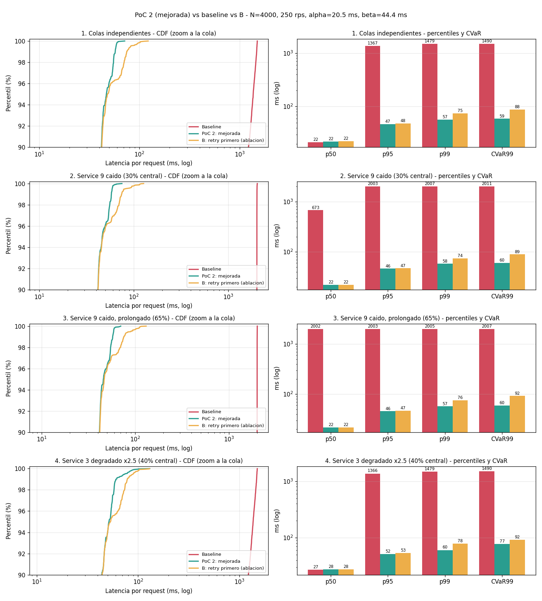

# PoC 2 - El diagrama con mejoras

Parte de la misma arquitectura del diagrama, con los cambios que salieron de comparar la PoC 1 contra una iteración intermedia (la variante B de este README, que reintenta antes de usar la caché). Diagrama: `arquitectura-poc2.png`.


## Puntos débiles encontrados y qué se cambió

| Punto débil | Dónde se vio | Cambio en la PoC 2 |
|---|---|---|
| Con un servicio degradado (no caído), α fijo hedgea de más y se pasa del presupuesto de carga | PoC 1 en el escenario 4: 7.94% de carga extra | α y β se adaptan por servicio con la mediana móvil de latencia, sin pasar de 100 ms y manteniendo β - α ≥ 1.5 veces la mediana |
| La caché no tiene límite de antigüedad ni marca | PoC 1 en el escenario 3: sirvió datos de hasta 11.22 s | Caché de dos niveles: fresca (≤ 1 s) y vieja (≤ 5 s, solo con el breaker abierto o tras agotar reintentos). Pasado el TTL la llamada falla (GG) en vez de servir un dato más viejo. Todo dato de caché se marca como degradado |
| Reintentar antes de usar la caché cuesta latencia | Variante B: p99 74.9 ms contra 57.4 ms | Al vencer β, si la caché es fresca se responde de inmediato. Solo se reintenta cuando no hay dato fresco |
| Reintentos sin control | PoC 1 reintenta hasta 3 veces sin límite global | Backoff exponencial con jitter y presupuesto de reintentos (≤ 10% de las llamadas) |
| Al terminar el cooldown, el breaker deja pasar todas las llamadas | PoC 1 | Half-open con una sola sonda; el resto se cortocircuita mientras la sonda está en vuelo |
| β = β* × 1.5 era un margen puesto a ojo | PoC 1 | β se entrena exigiendo los timeouts también bajo una cola sana más pesada (σ 0.55 en vez de 0.35), sin factor manual |

Lo que no cambia: warm up de los 3 servicios problemáticos, hedged request a la réplica, breaker + fallback, retry máximo 3 y GG, y la caché solo para los servicios con warm up.

## Parámetros

Mismo método de entrenamiento que la PoC 1 (CVaR99 con búsqueda binaria, carga ≤ 5%, timeouts ≤ 0.5% por llamada) pero con β robusto: α = 20.5 ms, β* = 44.4 ms, β usado = 44.4 ms. Como β salió menor que en la PoC 1, parte de la mejora de p99 viene de ahí y no solo de la política de caché. Para separar los dos efectos se corre también la variante B con los mismos α y β.

## Cómo correrla

```bash
cd poc2_mejorada
python3 run.py train
python3 run.py experiment --scenario all     # o tails | outage_svc9 | outage_long_svc9 | drift_svc3
python3 run.py report
```

`mode="B"` en `ImprovedAPI` es la variante que reintenta antes de usar la caché; se deja solo para comparar.

# Resultados del experimento - PoC 2

Baseline = fan-out a los 10 servicios esperando al más lento. B = misma PoC 2 pero reintentando antes de usar la caché (mismos α y β). Misma simulación y mismas latencias que en la PoC 1.

<!-- RESULTS:START -->
**Parametros entrenados** (objetivo CVaR99, biseccion, beta robusto; seed de entrenamiento 7, evaluacion 42): alpha = 20.5 ms, beta* = 44.4 ms (minimo factible en nominal y con cola sana pesada), beta usado = 44.4 ms.
Carga: 4000 requests por corrida a 250 rps (open-loop). TTL fresco 1 s, TTL maximo 5 s.

#### 1. Colas independientes

| Metrica | Baseline | PoC 2: mejorada | B: retry primero (ablacion) |
|---|---:|---:|---:|
| p50 (ms) | 21.6 | 22.2 | 22.4 |
| p95 (ms) | 1366.6 | 46.9 | 48.1 |
| p99 (ms) | 1479.3 | 57.4 | 74.9 |
| CVaR99 (ms) | 1489.9 | 59.2 | 87.6 |
| Requests ejecutadas | 4000 | 4000 | 4000 |
| Llamadas a backend | 40000 | 41902 | 42066 |
| Carga extra | 0.0% | 4.75% | 5.16% |
| Requests degradadas (dato de cache) | 0 (0.0%) | 131 (3.28%) | 0 (0.0%) |
| Requests con llamada fallida (GG) | 0 (0.0%) | 0 (0.0%) | 0 (0.0%) |
| Hedges / retries / timeouts | 0 / 0 / 0 | 1899 / 3 / 134 | 1930 / 136 / 136 |
| Antiguedad max. del dato de cache (s) | - | 0.01 | 0 |
| Lag p99 del event loop (ms) | 2.19 | 1.65 | 2.01 |

#### 2. Service 9 caido (30% central)

| Metrica | Baseline | PoC 2: mejorada | B: retry primero (ablacion) |
|---|---:|---:|---:|
| p50 (ms) | 672.9 | 22.2 | 22.2 |
| p95 (ms) | 2003.0 | 46.4 | 47.2 |
| p99 (ms) | 2007.0 | 58.0 | 74.4 |
| CVaR99 (ms) | 2010.8 | 60.3 | 89.3 |
| Requests ejecutadas | 4000 | 4000 | 4000 |
| Llamadas a backend | 40000 | 40474 | 40625 |
| Carga extra | 0.0% | 1.18% | 1.56% |
| Requests degradadas (dato de cache) | 0 (0.0%) | 1332 (33.3%) | 1253 (31.32%) |
| Requests con llamada fallida (GG) | 0 (0.0%) | 94 (2.35%) | 92 (2.3%) |
| Hedges / retries / timeouts | 0 / 0 / 0 | 1794 / 4 / 139 | 1827 / 120 / 143 |
| Antiguedad max. del dato de cache (s) | - | 5.0 | 5.0 |
| Lag p99 del event loop (ms) | 3.19 | 1.75 | 1.97 |

#### 3. Service 9 caido, prolongado (65%)

| Metrica | Baseline | PoC 2: mejorada | B: retry primero (ablacion) |
|---|---:|---:|---:|
| p50 (ms) | 2001.7 | 21.9 | 21.9 |
| p95 (ms) | 2003.2 | 45.7 | 46.7 |
| p99 (ms) | 2005.0 | 57.4 | 75.8 |
| CVaR99 (ms) | 2006.7 | 59.7 | 92.4 |
| Requests ejecutadas | 4000 | 4000 | 4000 |
| Llamadas a backend | 40000 | 39045 | 39175 |
| Carga extra | 0.0% | -2.39% | -2.06% |
| Requests degradadas (dato de cache) | 0 (0.0%) | 1295 (32.38%) | 1269 (31.72%) |
| Requests con llamada fallida (GG) | 0 (0.0%) | 1397 (34.92%) | 1397 (34.92%) |
| Hedges / retries / timeouts | 0 / 0 / 0 | 1670 / 3 / 127 | 1700 / 110 / 141 |
| Antiguedad max. del dato de cache (s) | - | 5.0 | 5.0 |
| Lag p99 del event loop (ms) | 2.32 | 2.06 | 1.95 |

#### 4. Service 3 degradado x2.5 (40% central)

| Metrica | Baseline | PoC 2: mejorada | B: retry primero (ablacion) |
|---|---:|---:|---:|
| p50 (ms) | 27.0 | 27.5 | 27.5 |
| p95 (ms) | 1366.2 | 51.6 | 53.4 |
| p99 (ms) | 1479.3 | 60.4 | 78.2 |
| CVaR99 (ms) | 1489.9 | 77.1 | 91.9 |
| Requests ejecutadas | 4000 | 4000 | 4000 |
| Llamadas a backend | 40000 | 41955 | 42134 |
| Carga extra | 0.0% | 4.89% | 5.34% |
| Requests degradadas (dato de cache) | 0 (0.0%) | 131 (3.28%) | 0 (0.0%) |
| Requests con llamada fallida (GG) | 0 (0.0%) | 0 (0.0%) | 0 (0.0%) |
| Hedges / retries / timeouts | 0 / 0 / 0 | 1949 / 6 / 137 | 1996 / 138 / 138 |
| Antiguedad max. del dato de cache (s) | - | 0.01 | 0 |
| Lag p99 del event loop (ms) | 3.54 | 2.01 | 1.96 |


<!-- RESULTS:END -->
