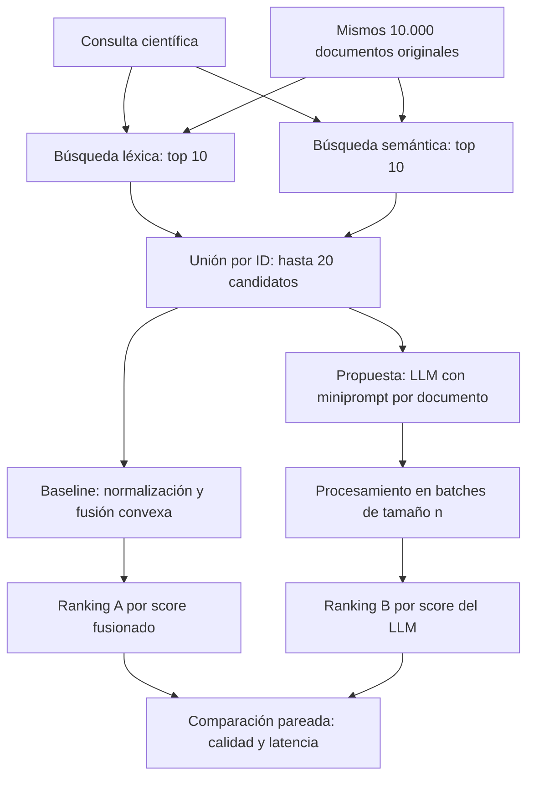

# Plan de experimentación: búsqueda híbrida con fusión convexa frente a puntuación con LLM

**Fecha:** 19 de noviembre de 2026.
**Presupuesto:** entre 5 y 8 horas de trabajo en paralelo para tres integrantes.
**Estado:** plan de ejecución; no contiene resultados experimentales. El fallo numérico observado en el piloto de Khipu sigue pendiente de resolución.
**Aplicación:** buscador de evidencia científica sobre COVID-19.

## 1. Pregunta de investigación

¿Sustituir la fusión convexa por un LLM que puntúa documentos mediante miniprompts mejora la relevancia del ranking, y qué coste adicional de latencia introduce? ¿Cómo cambia ese coste al variar el tamaño del batch y la concurrencia?

La mejora es una hipótesis, no un resultado esperado que deba cumplirse. Una conclusión negativa también es válida: el LLM podría no mejorar la calidad, introducir demasiado tiempo o depender excesivamente del prompt.

## 2. Arquitectura que se compara

Los dos sistemas ejecutan la misma búsqueda léxica y semántica, en paralelo, sobre el mismo corpus. Ambos reciben exactamente la misma unión de candidatos. Solo cambia la etapa final de puntuación y ranking.



- **Unión:** combinar resultados por ID y eliminar duplicados. No juntar textos ni resumir documentos.
- **Baseline:** obtener ambos scores para cada candidato, normalizarlos por consulta y aplicar `score = 0,15 × léxico_normalizado + 0,85 × semántico_normalizado`. Si un documento llegó por una sola búsqueda, calcular también su otro score; no asignarle cero por ausencia del top 10. Reutilizar la normalización documentada del trabajo anterior y registrar el tratamiento de columnas constantes.
- **Propuesta:** cada entrada es un par consulta-documento y un miniprompt fijo. El LLM no recibe los juicios de relevancia ni el ranking del baseline. Se ordena únicamente por el score del LLM, sin una segunda fusión.
- **Batch n:** procesar hasta n pares independientes juntos en un modelo cargado. No implica n copias del modelo ni un prompt que compara varios documentos a la vez.
- **Empates:** ID de documento ascendente en ambos sistemas.

Este trabajo no incorpora un estudio de construcción de índices. Se reutilizará la preparación de búsqueda disponible cuando sea compatible; su coste se informará por separado. La medición principal de consulta incluye búsqueda léxica, búsqueda semántica, unión, puntuación final y ordenamiento, con modelos cargados. Guardar candidatos permite verificar la igualdad y hacer análisis posteriores; no permite omitir las búsquedas en la medición del flujo completo.

## 3. Protocolo común que debe congelarse antes de ejecutar

| Elemento | Decisión |
|---|---|
| Dataset | TREC-COVID: documentos originales, consultas y juicios oficiales disponibles |
| Corpus | Una única muestra de 10.000 documentos, semilla 42, sin incorporar positivos para favorecer resultados |
| Consultas | Las 50 disponibles; fijar de antemano 10 para diagnóstico complementario, semilla 43 |
| Candidatos | Top 10 léxico y top 10 semántico; misma unión por consulta, máximo 20 |
| Baseline | α semántico = 0,85, transferido del ajuste previo en FiQA-dev; no reajustarlo en TREC-COVID |
| Modelo | Un único modelo y revisión, inicialmente Qwen/Qwen2.5-3B-Instruct; sin fallback silencioso |
| Texto | Documento original; registrar límite de tokens y proporción truncada; sin resúmenes generados |
| Prompt principal | Congelado antes de evaluar; mismo en todas las pruebas principales |
| Desempate | ID ascendente |
| Bootstrap | 10.000 remuestreos pareados de consultas, semilla 42 |
| Separación | Carpeta nueva por experimento; nunca reutilizar resultados de smoke como corridas completas |

Registrar el hash del corpus, consultas, qrels, candidatos, código y prompt; el modelo y revisión; el hardware; las versiones de librerías y las semillas. Si se cambia algo después de un fallo, conservar el intento y crear una configuración identificable.

Los juicios de TREC-COVID son graduados; no es necesario que coincidan con el rango numérico del LLM. Para P@3 y MRR@10, considerar relevante un juicio mayor que cero. Para nDCG@3, fijar y registrar la ganancia `2^rel - 1` y el descuento `log2(posición + 1)`. Excluir juicios negativos/no válidos de las etiquetas evaluables. Distinguir un documento no juzgado de uno juzgado como no relevante, aunque la evaluación convencional asigne contribución cero a ambos.

El universo evaluado es la muestra de 10.000 documentos. Para nDCG, construir el ranking ideal usando todos los documentos juzgados de esa muestra para la consulta, no solo los candidatos recuperados. Informar cuántas consultas tienen al menos un relevante en la muestra. Publicar el promedio sobre las 50 y, adicionalmente, sobre las que tienen positivos en la muestra, sin ocultar las restantes ni reemplazarlas.

La puntuación del LLM debe tener una definición única. Si se usa el esquema del piloto, obtener la esperanza de las etiquetas 0–4 y dividir entre 4 a partir de sus probabilidades normalizadas. No mezclar este esquema con generación libre de decimales entre corridas. Un score no es una probabilidad calibrada de verdad científica. Detectar NaN, infinitos y salidas inválidas: no convertirlos silenciosamente en cero.

## 4. Reparto entre tres integrantes

| Responsable | Trabajo principal | GPU | Resultado que añade |
|---|---|---|---|
| Tú | Comparación principal, batching, concurrencia, latencia y recuperación | Khipu; Kaggle como respaldo | Calidad frente a coste y configuración práctica |
| Compañero 1 | Sensibilidad a un cambio controlado de miniprompt | Kaggle o GPU propia disponible | Robustez del método: cuánto depende de redactar el prompt de una forma concreta |
| Compañero 2 | Cobertura, ranking ideal de candidatos, auditoría y errores | No necesaria | Distinguir fallos de recuperación, ordenamiento y evaluación |

Nadie necesita repetir todos tus experimentos. Cada compañero dispone de un alcance que puede cerrar en menos tiempo que la corrida principal.

## 5. Tu trabajo: experimentación principal

### E1. Calidad de ranking

Evaluar las 50 consultas con las dos variantes sobre los mismos candidatos: como máximo 1.000 pares para la puntuación LLM principal. Guardar todos los scores y rankings.

Reportar:

- P@3, nDCG@3 y MRR@10 de ambos sistemas.
- Diferencia LLM menos fusión, con IC del 95 % pareado por consulta.
- Número de consultas que mejoran, empatan y empeoran, por métrica.
- Cobertura de positivos en el corpus reducido y número de candidatos por consulta.

No volver a ejecutar el modelo para calcular intervalos: el bootstrap reutiliza las métricas por consulta. TREC-COVID ya se utilizó en trabajos anteriores, por lo que el resultado se presentará como análisis exploratorio, sin afirmar una evaluación ciega nueva.

### E2. Batch y estabilidad

Usar un subconjunto fijo de 10 consultas y los mismos pares. Comparar batches 1, 4 y 8, con calentamiento excluido de la medición y tres repeticiones en orden aleatorizado, semilla 44.

Medir tiempo, pares por segundo, pico de memoria GPU, errores y diferencias de scores/rankings entre tamaños. No dividir automáticamente un batch que falla y luego reportarlo como si hubiera funcionado: registrar su fallo y el tamaño efectivo.

Elegir el batch más rápido entre los probados que complete todos los pares, mantenga scores válidos y cumpla una tolerancia de estabilidad fijada antes de comparar. Para este plan: diferencia máxima absoluta de score ≤ 0,001 frente a batch 1 y los mismos top 3 por consulta. Si ninguno cumple, conservar batch 1 y reportar la inestabilidad; no relajar la regla para favorecer una configuración.

### E3. Concurrencia acotada

Con el batch elegido, probar 1, 2 y 4 consultas en curso. Usar el mismo conjunto, un modelo cargado y una cola acotada; registrar cómo se agrupan los pares de cada solicitud y cuándo se considera terminada.

Comenzar con 50 solicitudes por nivel. Medir solicitudes completadas por segundo, tiempo desde entrada a la cola hasta respuesta, espera en cola y errores. Reservar el mismo presupuesto de CPU/GPU para todos los niveles. Registrar cualquier capacidad de cola o política de rechazo.

La conclusión será «la mejor concurrencia entre 1, 2 y 4 bajo esta carga», no un óptimo universal. Una prueba con clientes de concurrencia fija mide carga cerrada; no demuestra capacidad ante llegadas abiertas ni disponibilidad de producción.

### E4. Latencia del flujo completo

Comparar baseline y propuesta con sus etapas completas. Separar carga inicial y preparación de la latencia con modelos cargados. Alternar el orden de las variantes para reducir el efecto de calentamiento y cambios del entorno. Conservar por solicitud los tiempos de búsqueda, unión, puntuación final, cola y total.

Priorizar la condición de una consulta en curso para medir el coste adicional directo. Si hay tiempo, ampliar también la mejor configuración concurrente. Objetivo máximo: 1.000 solicitudes por sistema, recorriendo una secuencia fija de las 50 consultas, sin caché de respuestas ni de scores LLM en este experimento. Reutilizar los modelos y la representación documental preparada sí forma parte del escenario de servicio descrito.

Reportar p50, p95, p99, número de solicitudes, duración y errores. Si el presupuesto no alcanza, publicar la muestra real; con menos de 1.000 solicitudes, tratar especialmente p99 como exploratorio. Incluso con 1.000, las colas extremas tienen incertidumbre y las consultas repetidas no equivalen a 1.000 consultas distintas. No usar repeticiones de rendimiento para aumentar artificialmente la muestra de calidad, que sigue siendo de 50 consultas.

### E5. Recuperación mínima

Interrumpir una corrida pequeña después de un checkpoint y reanudar. Verificar que cada par consulta-documento aparece exactamente una vez y que el resultado coincide con una ejecución de referencia. Registrar trabajo rehecho, pérdidas y duplicados. No confundir esta comprobación con una medición de disponibilidad de un servicio.

## 6. Compañero 1: robustez del miniprompt

**Pregunta:** ¿la propuesta depende demasiado de una redacción específica del prompt?

### Instrucciones para compartir

1. Trabaja en una carpeta o rama independiente. Usa el manifiesto, modelo, revisión, límite de tokens, método de score y candidatos que te compartirá el responsable principal.
2. Usa únicamente las 10 consultas complementarias fijadas antes de evaluar: hasta 200 pares. No elijas consultas donde el LLM ya ganó o perdió.
3. Ejecuta dos redacciones semánticamente equivalentes: el prompt principal y una paráfrasis fijada antes de ver resultados. Conserva exactamente la misma escala y método de puntuación; no cambies modelo, corpus ni instrucciones sustantivas de relevancia. Guarda el texto completo de ambos prompts.
4. Usa un batch fijo válido, preferiblemente 4 si pasa la comprobación técnica. No hagas un barrido de batches: eso ya se mide en el experimento principal.
5. Calcula P@3, nDCG@3 y MRR@10 por prompt; cambios de top 3 por consulta; diferencia absoluta media y máxima de scores; frecuencia de scores inválidos. Los resultados sobre 10 consultas son descriptivos, con incertidumbre alta.
6. Conserva todos los resultados, aunque el prompt alternativo sea peor. No reemplaces el prompt del experimento principal por el que mejor funcione en estas consultas.
7. Si tu GPU difiere de la principal, ejecuta ambos prompts en tu propia GPU. Compara los prompts dentro de tu plataforma; no atribuyas diferencias de latencia entre plataformas al prompt.

**Presupuesto:** hasta 2–4 horas, incluida preparación. Máximo 400 pares si se ejecutan ambas versiones una vez. No son dos réplicas completas del proyecto.

**Entregables:** `prompts.json`, `scores_por_prompt.csv`, `metricas_por_consulta.csv`, `resumen_prompt.csv`, una gráfica, código, manifiesto y log. Una página de interpretación: sensibilidad observada y límites.

**Si no hay GPU o el entorno falla:** no cambiar el modelo y presentar los resultados como comparables. Pasar al análisis CPU de estabilidad de scores y empates por batch cuando estén disponibles. Marcar el experimento de prompts como no ejecutado; no fabricar una réplica.

**Valor:** permite explicar si el resultado central es estable ante una pequeña variación de redacción o si requiere más investigación sobre prompts. No sirve para demostrar que un prompt fue optimizado.

## 7. Compañero 2: cobertura, techo de calidad y análisis de errores

**Pregunta:** cuando un sistema falla, ¿la evidencia relevante no fue recuperada o fue ordenada incorrectamente?

### Instrucciones para compartir

1. Prepara el análisis sin GPU. Recibirás corpus seleccionado o lista de IDs, consultas, qrels, rankings léxico/semántico, candidatos y ambos rankings finales.
2. Audita que las uniones no tengan duplicados y sean idénticas para ambos métodos. Comprueba que los rankings no incorporen IDs externos y que cada candidato tenga sus scores correspondientes.
3. Calcula cuántos relevantes hay por consulta en la muestra y cuántos están en los candidatos. Reporta cobertura de consultas con algún relevante recuperado y recall de candidatos respecto a los positivos juzgados del corpus seleccionado. Cuando no haya positivos, registra el denominador cero como no aplicable, no como recall cero. Distingue no juzgados de juicios explícitos cero.
4. Calcula el ranking ideal dentro de la unión, ordenando por juicio conocido y desempate por ID. Evalúalo con los mismos denominadores del experimento principal. Es un techo diagnóstico bajo los juicios disponibles, no un sistema utilizable: usa etiquetas que los métodos reales no conocen.
5. Añade las variantes «solo léxico» y «solo semántico» usando los scores ya guardados sobre la misma unión. No hace falta otra inferencia. Así comprobamos si la mejora requiere combinar señales o si una señal ya explica el resultado.
6. Selecciona ejemplos mediante una regla objetiva: tres mayores mejoras y tres mayores empeoramientos del LLM en nDCG@3, con desempate por ID de consulta. Muestra consulta, documentos intercambiados, juicios, scores y una explicación apoyada en fragmentos originales.
7. Identifica truncación, documentos no juzgados, coincidencia superficial de palabras o desacuerdo temático como posibles explicaciones; distinguir observación de interpretación. No cambiar etiquetas por intuición ni usar otro LLM como verdad de referencia.

**Presupuesto:** 2–4 horas de trabajo, mayormente CPU, con tiempo adicional para documentar si los resultados principales tardan en llegar. Puede preparar tablas, validadores y plantillas mientras espera los scores del LLM.

**Entregables:** `auditoria.json`, `cobertura_por_consulta.csv`, `oracle_y_ablaciones.csv`, `ejemplos_errores.md`, una figura de cobertura y brecha frente al ideal, código y log.

**Valor:** impide atribuir al LLM un problema de recuperación. Si los relevantes no aparecen en la unión, cambiar la puntuación final no puede recuperarlos. Si sí aparecen y el LLM los baja de posición, el problema está en su ordenamiento.

## 8. Cronograma conjunto y reglas de parada

| Hora desde inicio | Tú | Compañero 1 | Compañero 2 |
|---|---|---|---|
| 0–1 | Comprobación de inferencia, manifiesto y candidatos | Preparar entorno y congelar paráfrasis | Preparar auditoría y cálculo de métricas |
| 1–2,5 | Calidad principal | Comparación de prompts | Cobertura y ranking ideal; incorporar rankings al llegar |
| 2,5–4 | Batches y concurrencia | Verificación y gráfico | Ablaciones y ejemplos de errores |
| 4–6 | Latencia y recuperación | Entrega de carpeta y nota de resultados | Entrega de carpeta y nota de resultados |
| 6–7 | Consolidación y notebook | Corregir incidencias de su entrega si quedan | Revisar interpretación de sus resultados |
| 7–8 | Margen y cierre obligatorio | Sin corridas nuevas | Sin corridas nuevas |

Las franjas son un presupuesto, no una predicción de Slurm o Kaggle. El reloj incluye espera y preparación; una cola larga reduce el alcance de rendimiento disponible.

Reglas:

- Una inferencia real y un batch corto deben producir scores finitos antes de lanzar calidad. No continuar con NaN ni convertirlo a irrelevancia.
- Dedicar como máximo 20 minutos al diagnóstico inicial en Khipu; después comprobar Kaggle como alternativa. Esto limita un intento de diagnóstico, no garantiza que la alternativa funcione.
- Si hay que cambiar modelo o precisión por viabilidad, registrar el cambio y compartirlo antes de comparar. Los resultados de configuraciones diferentes se separan.
- Prioridad: calidad válida, batch válido, análisis complementarios, concurrencia y ampliación de latencia. Reducir repeticiones de rendimiento antes que descartar consultas por resultados desfavorables.
- Al cumplirse seis horas, no iniciar un benchmark que, según el throughput medido, no termine antes de la séptima. Reservar la última hora para verificación y empaquetado.
- Si se acaba el tiempo, publicar qué se completó, qué falló y qué quedó sin ejecutar. No estimar métricas ausentes como si fueran observaciones.

## 9. Intercambio de archivos y reproducibilidad

Compartir una vez el paquete común, sin contraseñas, tokens, entornos virtuales ni pesos del modelo:

```text
entrada_comun/
  manifiesto.json
  corpus_ids.txt
  consultas.jsonl
  qrels.tsv
  candidatos.jsonl
  scores_lexicos_semanticos.csv
  prompt_principal.txt
  requisitos.txt
```

Cada fila de candidatos/scores identifica al menos `query_id`, `doc_id`, rango léxico original si existe, rango semántico original si existe, scores originales, scores normalizados y score de fusión. Cada candidato tiene una referencia inequívoca al texto original compartido; añadir un `corpus_10000.jsonl` común si no todos tienen ese mismo corpus localmente. Registrar el hash de ese archivo y el número de consultas, documentos y pares.

En resultados, cada fila identifica configuración, consulta, documento cuando corresponda, semilla y hardware. Los logs deben registrar errores y tamaños efectivos de batch. Las pruebas de prompt quedan claramente separadas de la comparación principal.

```text
experimento_final/
  protocolo_y_manifiestos/
  principal/
    calidad/
    batching/
    concurrencia/
    latencia/
    recuperacion/
  complemento_prompts/
  complemento_cobertura_errores/
  codigo/
  logs/
  figuras/
  notebook_ejecutado.ipynb
  informe.md
```

No depender de que «la primera corrida que termine» sea la oficial: la configuración principal se designa antes y debe superar la auditoría. Otra plataforma puede ser respaldo o réplica identificada. Las latencias de T4 y A6000 no se mezclan; comparar tratamientos dentro de cada hardware y anotar si el recurso estuvo compartido.

## 10. Qué podremos defender ante el jurado

1. Una comparación controlada: mismas búsquedas, candidatos, documentos y etiquetas; solo cambia la puntuación final.
2. Evidencia de calidad con resultados por consulta y diferencias pareadas, sin prometer que el LLM ganará.
3. Un coste medido de la propuesta y una evaluación acotada de batch/concurrencia.
4. Un estudio complementario de sensibilidad al miniprompt.
5. Una explicación de errores que separa recuperar evidencia de ordenar evidencia.
6. Un procedimiento reproducible y una comprobación básica de recuperación.

No se afirmará calibración probabilística del score, óptimo universal de paralelismo, disponibilidad de producción, suficiencia clínica de la evidencia ni generalización a toda la literatura científica. El corpus reducido, los juicios incompletos, las 50 consultas y el historial de uso de TREC-COVID limitan las conclusiones. La contribución es estudiar la sustitución controlada de la etapa final de ranking y su equilibrio entre relevancia, coste y robustez.
