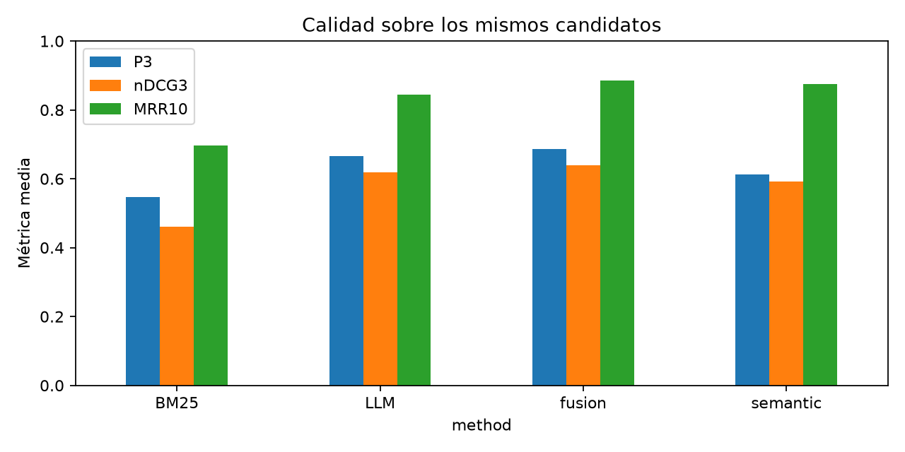

# TREC-COVID experiment results

Completed on 19 November 2026. This directory publishes the main experiments comparing convex fusion with pointwise LLM scoring after **the same lexical and semantic retrieval and candidate union**. It is a self-contained result package; it does not replace the team's `feat/calidad-comparacion` implementation or include teammates' complementary experiments.

## Main finding

On 10,000 sampled documents and 50 queries, the LLM did not demonstrate an improvement over convex fusion. All paired quality confidence intervals include zero; mean quality favored fusion. The LLM pipeline also had substantially higher measured latency on the recorded FP32/A100 MIG configuration. These results do not establish universal LLM inferiority or statistical equivalence.

| Method | P@3 | nDCG@3 | MRR@10 | Mean warm end-to-end latency |
|---|---:|---:|---:|---:|
| Convex fusion | 0.6867 | 0.6402 | 0.8857 | 22.35 ms |
| Pointwise LLM | 0.6667 | 0.6180 | 0.8446 | 7.296 s |

Read the [full interpretation, preserved in Spanish](RESULTADOS_E_INTERPRETACION.md), the [executed notebook](experimentos_ejecutados.ipynb), and the [original automatic report](resultados/informe.md). The [experiment plan](PLAN_EXPERIMENTACION_EQUIPO_5_A_8_HORAS.md) describes the agreed scope, budget, and complementary team assignments.

## Experiments and evidence

| Experiment | Scope | Main evidence |
|---|---|---|
| Ranking quality | 50 queries, 893 query-document pairs, identical candidates | [Per-query metrics](resultados/calidad_por_consulta.csv), [paired bootstrap CIs](resultados/diferencias_pareadas.csv), [LLM scores](resultados/scores_llm.json), [rankings](resultados/rankings.json) |
| Batch size | 177 identical pairs, batch 1/4/8, three repeats | [Measurements](resultados/batches.csv), [stability](resultados/estabilidad_batches.csv); batch 1 selected |
| Query concurrency | 1/2/4 concurrent clients, 50 requests per condition | [Requests](resultados/concurrencia_solicitudes.csv), [summary](resultados/concurrencia_resumen.csv) |
| Full-pipeline latency | 1,000 requests per method, zero request errors | [Requests](resultados/latencia_solicitudes.csv), [percentiles](resultados/latencia_resumen.csv) |
| Checkpoint recovery | Abrupt subprocess exit and replay of 40 reference scores | [Result and scope](resultados/recuperacion.json) |

Jobs 64078, 64079 and 64080 completed successfully in 00:08:18, 02:34:21 and 00:00:14 respectively. GPU stages used `ag001`, **A100-PCIE-40GB MIG 3g.20gb**, not a full A100, T4 or RTX A6000. CPU analysis used `n003`. See [final Slurm accounting](slurm_final_verificado.csv) and [sanitized logs](logs/).

Quality was measured with batch 4; latency used selected batch 1. The 1,000 LLM latency responses all matched the quality run's top three documents. This checks top-three agreement, not complete top-ten equality. See [local verification](verificacion_local.json).



## Interpretation limits

- Data: a uniformly sampled 10,000-document subset of the public [BEIR TREC-COVID dataset](https://github.com/beir-cellar/beir); original document text was used without generated summaries.
- The 50 queries all retained judged positives in the subset. Relevance judgments are incomplete, and previously observed TREC-COVID topics make this exploratory rather than fresh blind validation.
- Fusion uses per-query candidate-union min-max normalization and fixed semantic weight 0.85 transferred from earlier FiQA-dev work. It was not tuned on this experiment's TREC-COVID outcomes.
- LLM: `Qwen/Qwen2.5-3B-Instruct`, revision `aa8e72537993ba99e69dfaafa59ed015b17504d1`, FP32, TF32 disabled. The relevance score is the conditional expected digit 0–4 divided by four, not a calibrated probability.
- Concurrency used one model instance and a serialized GPU lane. Additional clients increased queueing; this is not an experiment with independent LLM replicas or dynamic cross-query batching.
- Latency repeats 50 topics with warm models and no response/LLM-score cache. Repetitions do not increase the number of independent quality topics. Tail estimates retain sampling and workload uncertainty.
- Recovery validates persistence/replay of reference scores, not full inference recovery after a machine failure or production availability.
- Larger batches were slower here. Padding and FP32 overhead are possible explanations, not isolated causal findings.

## Directory layout

```text
resultados/       Numeric observations, metrics, rankings, protocol and five figures
entrada_comun/    Corpus IDs, public queries/qrels, prompt and retrieval scores
logs/            Sanitized Slurm logs, including numerical checks and smoke test
provenance/      Original-source hashes and publication/redaction description
*.py             Portable copies of executed experiment and analysis source
*.sbatch         Parameterized Slurm launchers
```

## Read or validate results without GPU

The executed notebook already contains its outputs. To check package integrity and key invariants using only Python's standard library:

```bash
cd paper/resultados/trec-covid-20261119
python verify_publication.py
```

To recompute statistics and execute a fresh analysis notebook in a **separate copy** of this directory, install compatible NumPy, pandas, matplotlib, tabulate, nbformat, nbclient and ipykernel, then run `python report.py`. This reads saved measurements; it does not run inference. Preserve this published snapshot before recomputation. The [observed environment freeze](entorno_pip.txt) records the actual installation; it is not a claim that a fresh installation on another platform was tested.

## Reproduce GPU runs

The portable code preserves scoring, metrics, prompts and experimental settings. Filesystem configuration, Slurm account/interpreter selection and new job IDs are parameterized. The exact unmodified source remains in the private workspace; its SHA-256 fingerprints are retained in [provenance](provenance/original_artifact_sha256.json).

1. Obtain the public BEIR TREC-COVID files: `corpus.jsonl`, `queries.jsonl`, and `qrels/test.tsv`. Check their source hashes against [the protocol](resultados/protocolo.json). The seed-42 sample depends on original corpus order; `entrada_comun/corpus_ids.txt` records the actual 10,000 IDs.
2. Download the recorded Qwen snapshot above and `BAAI/bge-base-en-v1.5`, revision `a5beb1e3e68b9ab74eb54cfd186867f64f240e1a`. Configure local snapshot paths; never commit weights or credentials.
3. Use a compatible CUDA environment based on the recorded Python/library metadata. The original environment used PyTorch 2.14.1 and Transformers 4.48.3. Launch inference through Slurm, not on a login node.
4. Set the following environment variables to your own paths/account:

```bash
export MINION_EXPERIMENT_ROOT=/path/to/a/fresh/experiment-copy
export MINION_PYTHON=/path/to/venv/bin/python
export MINION_DATA_ROOT=/path/to/trec-covid
export MINION_BGE_PATH=/path/to/local-bge-snapshot
export MINION_LLM_PATH=/path/to/local-qwen-snapshot
export SLURM_ACCOUNT=your_slurm_account
```

5. **Use a fresh run copy:** move its historical `resultados/`, `entrada_comun/`, `logs/`, `jobs.json` and `preflight_ok.json` to an archive outside that run directory. Keep this repository snapshot intact. The experiment intentionally rejects some reused outputs. Create an empty `logs/` directory and keep `modelo_preparado.json` plus the scripts.
6. Run `python run.py self-test`. Submit `sbatch --parsable --account="$SLURM_ACCOUNT" preflight.sbatch` and verify its success. Create `smoke_validation/`, copy `base.py`, `settings.py`, `run.py`, `report.py`, `modelo_preparado.json`, and the newly generated `preflight_ok.json` into it. Submit `smoke.sbatch` with the account option and verify success.
7. After both checks pass, submit the chain with their **new IDs**:

```bash
python submit.py --preflight-job NEW_PREFLIGHT_JOB_ID --smoke-job NEW_SMOKE_JOB_ID
```

GPU jobs retain the recorded Khipu A100 MIG resource request; adapt partition/GRES to another environment explicitly and label that run as a separate hardware configuration. Main requested walltimes sum to seven hours plus queueing. Performance work stops early once its target request count is met, or at its internal time budget. Analysis runs after completion/failure and does not invent missing observations.

## Public-release boundary

Included: executed notebook and outputs, result tables, per-query metrics, per-request timings, model scores, figures, code, revisions, seeds, source fingerprints and sanitized logs.

Excluded: SSH connection helper, credentials/tokens, usernames/private filesystem paths, full corpus/candidate text, raw private archive, weights/caches, FAISS/BM25 indexes, SQLite databases and virtual environments. Public corpus IDs, queries and judgment subsets preserve evaluation traceability without duplicating the document collection. Raw device/process dumps were omitted from environment JSON; relevant hardware metadata is retained. The [publication manifest](provenance/publication.json) describes transformations and exclusions. Original Spanish research documents are preserved as experiment artifacts.

The [public checksum manifest](PUBLIC_SHA256.json) applies to the released files. Original hashes describe the private, unmodified artifacts and must not be used as checksums for redacted copies.
