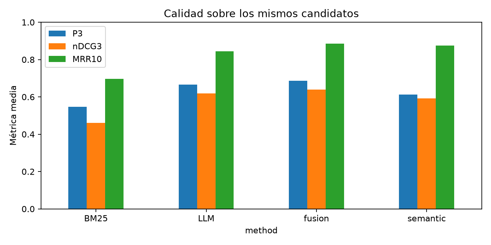
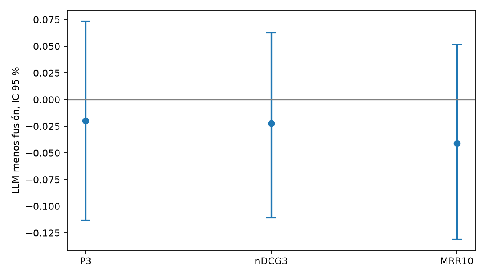
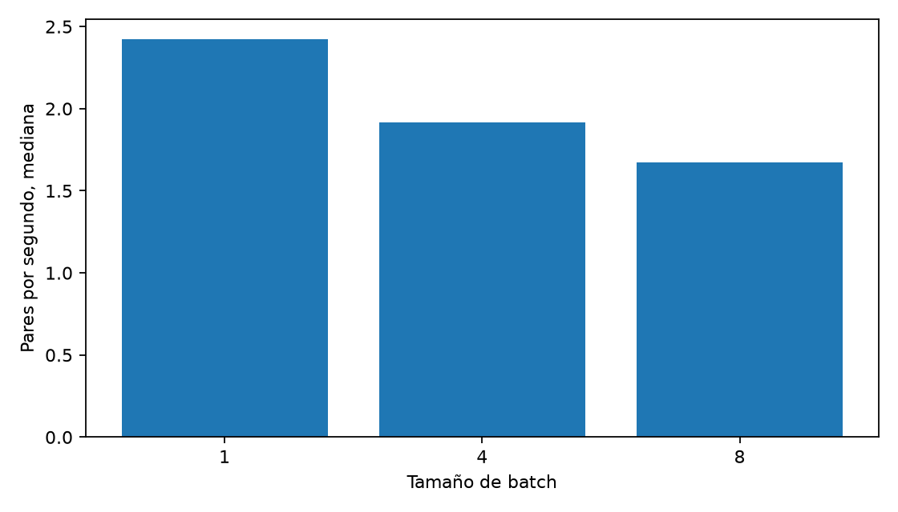
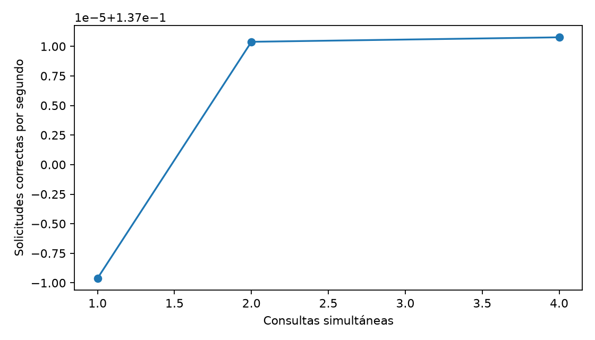
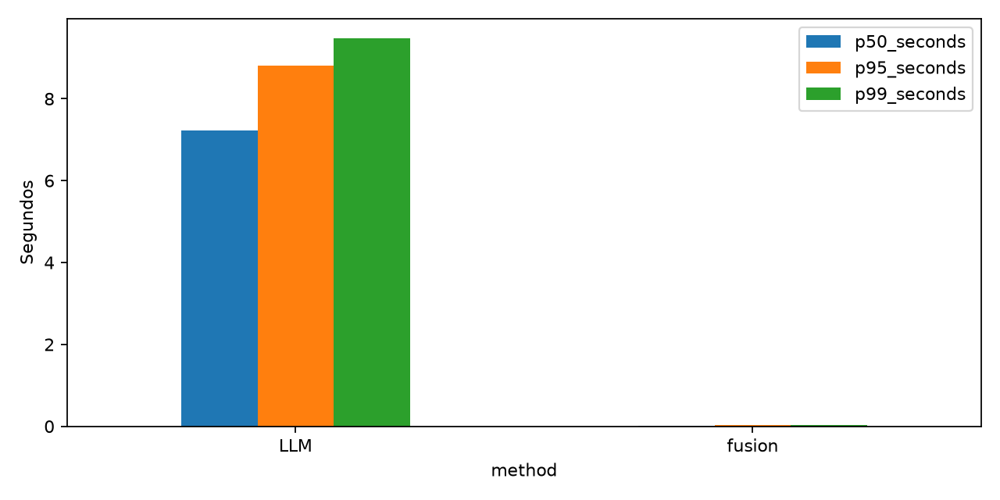

# Resultados e interpretación de los experimentos principales

Fecha de verificación: 19 de noviembre de 2026, hora de Lima. Todos los jobs principales terminaron correctamente. Este documento interpreta los resultados guardados; no incorpora resultados de los experimentos complementarios asignados a los compañeros.

## 1. Estado de ejecución

| Job | Etapa | Estado | Tiempo real | Nodo |
|---|---|---|---|---|
| 64078 | Calidad de ranking y recuperación de checkpoints | COMPLETED, salida 0 | 00:08:18 | ag001 |
| 64079 | Batches, concurrencia y latencia completa | COMPLETED, salida 0 | 02:34:21 | ag001 |
| 64080 | Estadísticas, figuras, informe y notebook | COMPLETED, salida 0 | 00:00:14 | n003, CPU |

El último job terminó a las **06:30:34 del 19/11/2026, hora de Lima**. El tiempo de ejecución sumado fue 2 h 42 min 53 s; el presupuesto máximo solicitado era de siete horas, no una duración mínima.

Hardware GPU: **NVIDIA A100-PCIE-40GB, instancia MIG 3g.20gb**. No corresponde a la RTX A6000 de trabajos anteriores ni a una T4 de Kaggle. Modelo Qwen2.5-3B-Instruct en FP32, con TF32 desactivado, sin cambios automáticos de modelo.

## 2. Qué se comparó

- Una muestra aleatoria de **10.000 documentos originales de TREC-COVID**, semilla 42.
- Las **50 consultas**, con juicios de relevancia oficiales restringidos al corpus seleccionado. Las 50 conservaron al menos un positivo juzgado dentro de la muestra.
- Por consulta: top 10 léxico y top 10 semántico; unión sin duplicados por ID. Se obtuvieron **893 pares consulta-documento** en total.
- Baseline: normalización min–max en esa unión y fusión `0,15 × léxico + 0,85 × semántico`.
- Propuesta: mismo conjunto de candidatos, puntuados individualmente con un LLM y miniprompt fijo; el ranking utiliza únicamente su score.
- Sin cross-encoder, sin resúmenes generados y sin usar qrels como entrada del LLM. Desempates por ID ascendente.

La auditoría local comprobó la igualdad de candidatos entre baseline y propuesta en las 50 consultas. Los scores léxicos y semánticos individuales se conservan como referencias adicionales.

## 3. Experimento de relevancia

| Método | Precision@3 | nDCG@3 | MRR@10 |
|---|---:|---:|---:|
| Solo léxico, BM25 | 0,5467 | 0,4600 | 0,6967 |
| Solo semántico | 0,6133 | 0,5928 | 0,8743 |
| **Fusión convexa** | **0,6867** | **0,6402** | **0,8857** |
| LLM con miniprompt | 0,6667 | 0,6180 | 0,8446 |

**Interpretación:** la fusión tuvo las mejores medias en las tres métricas. El LLM superó las referencias individuales en P@3 y nDCG@3, pero no mejoró el baseline fusionado. En MRR@10 también quedó por debajo de la búsqueda semántica sola.

En Precision@3, el baseline obtuvo 103 documentos relevantes entre las 150 posiciones evaluadas; el LLM obtuvo 100. Esto equivale a una diferencia de dos puntos porcentuales en la media de P@3.

### Incertidumbre pareada

Diferencia definida como **LLM menos fusión**. Bootstrap de 10.000 remuestreos de consultas, semilla 42.

| Métrica | Diferencia media | IC del 95 % | Consultas: mejora / empate / empeora |
|---|---:|---:|---|
| P@3 | −0,0200 | [−0,1133; +0,0733] | 14 / 22 / 14 |
| nDCG@3 | −0,0222 | [−0,1109; +0,0624] | 15 / 16 / 19 |
| MRR@10 | −0,0411 | [−0,1311; +0,0517] | 7 / 33 / 10 |

**Los tres intervalos incluyen cero.** Estos datos no aportan evidencia de superioridad del LLM ni permiten afirmar una inferioridad estadísticamente concluyente bajo este procedimiento. Tampoco demuestran equivalencia: con 50 consultas hay incertidumbre considerable.

La formulación defendible es: **la hipótesis de mejora del LLM no recibió apoyo en esta configuración; las medias favorecieron a la fusión**.

## 4. Experimento de tamaño de batch

Se utilizaron las mismas 10 consultas y **177 pares**, tres repeticiones por tamaño, con orden de configuraciones aleatorizado y sin incluir calentamiento.

| Batch | Tiempo mediano para 177 pares | Pares por segundo, mediana | Repeticiones correctas |
|---|---:|---:|---:|
| **1** | **73,03 s** | **2,424** | 3/3 |
| 4 | 92,46 s | 1,914 | 3/3 |
| 8 | 105,68 s | 1,675 | 3/3 |

Los tres tamaños completaron todos los pares, mantuvieron el mismo top 3 en las consultas de este ensayo y pasaron la tolerancia de diferencia máxima de score de 0,001. Las diferencias máximas observadas respecto a batch 1 fueron aproximadamente 0,0000495 y 0,0000442 para batches 4 y 8, respectivamente.

**Se seleccionó batch 1** por el menor tiempo mediano entre los tamaños válidos. Batch 4 tomó un 26,6 % más tiempo que batch 1, y batch 8 un 44,7 % más.

Esto demuestra que un batch mayor no garantiza mejor rendimiento en esta implementación. El padding de documentos con longitudes distintas y el coste de FP32 son posibles explicaciones, pero el experimento no aisló causalmente esos factores. No extrapolar el resultado a BF16, batching por longitud, otros modelos o GPUs.

La evaluación principal de calidad utilizó batch 4. La prueba extensa de latencia utilizó el batch 1 seleccionado. Como auditoría adicional, se comparó el top 3 de las **1.000 solicitudes LLM** de latencia con el ranking principal: **cero discrepancias**. Esto confirma la concordancia del top 3 observado; no verifica por sí solo que todo el top 10 sea idéntico en cada ejecución.

## 5. Experimento de concurrencia

50 solicitudes por nivel, batch 1, una instancia de modelo y una cola de clientes acotada. La GPU se ejecuta en una sola vía protegida por un mutex; la búsqueda léxica en CPU puede solaparse. Es una prueba de carga cerrada, no varias réplicas simultáneas del modelo ni batching dinámico entre consultas.

| Consultas simultáneas | Throughput correcto | p50 | p95 | Errores |
|---|---:|---:|---:|---:|
| **1** | 0,137 solicitudes/s | **7,23 s** | **8,76 s** | 0/50 |
| 2 | 0,137 solicitudes/s | 14,54 s | 16,85 s | 0/50 |
| 4 | 0,137 solicitudes/s | 29,13 s | 31,91 s | 0/50 |

**Interpretación:** admitir más consultas en paralelo aumentó la espera sin aumentar apreciablemente el throughput. Bajo esta arquitectura, la inferencia GPU serializada es el cuello de botella esperado. Una consulta en curso ofreció la menor latencia.

Este resultado no demuestra que «el paralelismo no sirve» ni que el óptimo universal sea uno. Demuestra el límite de este mecanismo concreto. Para estudiar paralelismo real del modelo se requeriría otra implementación, por ejemplo un planificador con batching dinámico o réplicas con memoria suficiente. Los percentiles de este ensayo de 50 solicitudes por nivel son exploratorios.

## 6. Experimento de latencia del flujo completo

**1.000 solicitudes por método**, sin errores: 2.000 solicitudes en total. Modelos cargados y representación documental preparada; búsqueda léxica y semántica reales, unión, puntuación final y ordenamiento en cada solicitud. No se reutilizaron respuestas ni scores LLM guardados. Se alternó el orden de los métodos con una secuencia reproducible.

| Método | Media | p50 | p95 | p99 | Errores |
|---|---:|---:|---:|---:|---:|
| **Fusión convexa** | **22,35 ms** | **22,30 ms** | **23,03 ms** | **23,66 ms** | 0/1.000 |
| LLM, batch 1 | 7,296 s | 7,231 s | 8,802 s | 9,480 s | 0/1.000 |

El flujo con LLM tuvo una latencia media aproximadamente **326 veces** la del baseline y añadió **7,274 segundos** por solicitud en promedio.

**Interpretación conjunta con calidad:** en esta configuración no se obtuvo una ganancia media de relevancia que compense el coste adicional. La fusión ofrece el mejor resultado observado para un buscador interactivo entre las dos variantes comparadas.

Los percentiles se calcularon sobre solicitudes correctas, y los errores se contaron por separado. Las 1.000 solicitudes repiten las mismas 50 consultas; no son 1.000 temas independientes ni una medición de tráfico real en producción. El p99 tiene incertidumbre incluso con esta muestra. La comparación no incluye el arranque en frío y es específica de la instancia MIG y de FP32.

## 7. Recuperación y validez de scores

- La prueba de recuperación terminó abruptamente un subproceso después de tres commits y reanudó la persistencia de 40 scores de referencia.
- Resultado final: **40/40 registros, cero pérdidas y cero duplicados**. Repetir la reanudación tampoco duplicó registros.
- Esta prueba valida el mecanismo de checkpoint y reintento bajo esa interrupción; no prueba caída del servidor, reanudación completa de inferencia ni disponibilidad de producción.
- **893/893 scores LLM válidos y finitos**, sin valores exactamente cero o uno.
- Cuatro pares tuvieron masa de probabilidad de etiquetas inferior a 0,5: **0,45 %**.
- Cuatro pares fueron truncados al límite de entrada: **0,45 %**. El conteo no implica que sean necesariamente los mismos cuatro pares.

No se sustituyeron NaN por cero ni se ocultaron fallos con un modelo alternativo. El score se calcula como la esperanza normalizada de etiquetas 0–4 y no es una probabilidad calibrada de relevancia o verdad científica.

## 8. Intentos técnicos previos

| Job | Propósito | Resultado |
|---|---|---|
| 64070 | Piloto previo en T4 | Falló por compilación del backend Triton antes de scores válidos |
| 64072 | Reintento del piloto en T4 | Falló por scores NaN; no se usó como resultado de calidad |
| 64075 | Comprobación A100 en BF16 | Scores finitos, pero deriva de score entre batches de aproximadamente 0,0245; no se adoptó |
| 64076 | Comprobación A100 en FP32 | Pasó; diferencia entre batches aproximadamente 0,0000175 |
| 64077 | Prueba completa aislada con dos consultas | COMPLETED, 00:03:24; incluyó calidad, rendimiento, recuperación, análisis y notebook |

Los tiempos y estados finales están en `slurm_final_verificado.csv`. El registro de accounting incluido originalmente en el paquete de análisis estaba vacío; se conserva en el archivo privado original y se añade esta consulta final verificada de Slurm como evidencia complementaria pública.

## 9. Conclusión para la investigación

> Con 10.000 documentos de TREC-COVID, 50 consultas y una recuperación híbrida común, sustituir la fusión convexa por la puntuación de Qwen2.5-3B-Instruct con un miniprompt fijo no mostró una mejora de relevancia. Las diferencias medias favorecieron a la fusión, aunque sus intervalos pareados incluyeron cero. El coste de latencia sí fue elevado: aproximadamente 7,30 s frente a 22,35 ms por solicitud en la configuración evaluada. Aumentar batch y concurrencia tampoco mejoró el rendimiento en esta implementación FP32 con acceso GPU serializado.

El resultado válido es un análisis del equilibrio entre calidad y rendimiento, no una demostración de que todo LLM sea inferior para ranking. Falta incorporar los complementos del equipo: sensibilidad al prompt y diagnóstico de cobertura/errores. No se ha ejecutado una réplica en Kaggle de esta serie principal.

## 10. Archivos y comprobaciones

- `experimentos_ejecutados.ipynb`: cinco celdas de código ejecutadas, cero errores.
- `resultados/informe.md`: informe automático original.
- `resultados/`: tablas agregadas, métricas por consulta, solicitudes de rendimiento, scores, rankings y cinco figuras.
- `entrada_comun/`: IDs de la muestra, consultas, qrels, scores léxicos/semánticos y manifiesto. El texto completo del corpus se conserva fuera de Git.
- Código y scripts Slurm en la raíz; logs en `logs/`.
- El paquete original descargado del clúster y su SHA-256 se conservan en el workspace privado; no se publican por contener datos y rutas sin depurar.
- `verificacion_local.json`: comprobación de 61 hashes internos sin discrepancias; igualdad de candidatos en todas las consultas; notebook ejecutado sin errores; concordancia del top 3 en las 1.000 solicitudes LLM de latencia.

El paquete original se conserva intacto fuera de Git. Las copias públicas están depuradas; `PUBLIC_SHA256.json` valida esta entrega y `provenance/` documenta las transformaciones y los hashes originales.
