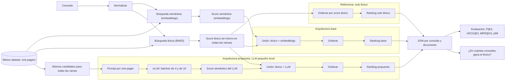

# Comparación de arquitecturas: base contra propuesta

Qué comparamos, con qué datos y cómo se mide. La arquitectura quedó validada con el profe el 19-nov.

## Qué se compara

Las dos arquitecturas usan **el mismo dataset, las mismas consultas y los mismos candidatos**. Solo cambia de dónde sale el score semántico. El score léxico (BM25) es el mismo en las dos.

| | Score léxico | Score semántico | Cómo se ordena |
| --- | --- | --- | --- |
| **Base** | BM25 | embeddings | unión de ambos y orden |
| **Propuesta** | BM25 (el mismo) | LLM pequeño local, sobre el one-pager | unión de ambos y orden |
| **Referencia** | BM25 | no lleva | orden por el score léxico |

La referencia "solo léxico" sirve para ver si el léxico solo le gana a alguna de las otras dos. Si le gana, la parte semántica no está aportando.



## Los dos tamaños de batch

Cada documento se puntúa por separado (pointwise, cada uno en su prompt); lo que cambia es cuántos se procesan en una
pasada del modelo. El profe pidió probar **batch de 4 y batch de 10**. Con 20 candidatos son 5 pasadas de 4 o 2 de 10.

La calidad debe salir **igual** en los dos (cada documento recibe el mismo score); solo cambia la latencia. Si el P@3
difiere, hay un error de implementación. Se reporta cuál cabe en el presupuesto de 1,2 s del reranking.

**Cómo se puntúa:** técnica RG-S (escala de relevancia 0-4 y esperanza sobre las probabilidades de cada etiqueta;
Zhuang et al., arXiv 2310.14122). El score es continuo entre 0 y 1, no binario. Detalle en `README.md`.

## Datos: el mismo corpus de one-pagers para todos

El profe pidió el mismo dataset en las dos arquitecturas, así que **las dos leen one-pagers**. Si solo la propuesta los usara, no sabríamos si la mejora viene del LLM o del resumen.

1. Elegir una submuestra del corpus (8.000 documentos, lo que dijo el profe) con `subsample_corpus.py --keep-splits dev test`. Conserva los relevantes de dev y test y completa al azar con semilla fija.
2. Generar un one-pager por cada documento de la submuestra con `generar_onepagers.py`, una sola vez y antes de medir. Guardarlos como indica `onepagers.py` (modelo, huella del prompt y semilla en cada línea).
3. `onepagers.py check` confirma que no falta ninguno. Con cobertura incompleta, la comparación queda sesgada, y `build` se niega a continuar.
4. `onepagers.py build` crea el dataset `-onepager`, que usan A y B para sus índices y consultas.

Tener en cuenta:
- Un corpus de 8.000 documentos es más fácil que el completo; los números no son comparables con los publicados de BEIR.
- Generar los one-pagers no entra en la latencia de consulta. Si se generaran por consulta, habría que medirlo aparte.
- Anotar modelo, prompt y semilla, y revisar a mano unos cuantos one-pagers por si el resumen pierde el detalle que hacía relevante al documento.

## Cómo se lee la comparación

```bash
python src/compare_rankings.py compare --qrels <qrels de test> ^
    --lexical results/lexico.run --base results/base.run --proposed results/propuesta.run ^
    --out results/comparacion
```

Genera tres archivos:

- `comparacion.comparison.md`: la tabla lista para leer. Tiene las métricas de cada ranking, cuántas consultas gana cada uno y el análisis por documento.
- `comparacion.join.csv`: una fila por (consulta, documento) con la posición y el score en cada ranking y el grado de BEIR. Sirve para ver casos concretos donde el léxico supera a la propuesta.
- `comparacion.comparison.json`: lo mismo para otros scripts.

**Análisis por documento (pointwise):** AUC (qué tan seguido un relevante recibe más score que uno no relevante) y Spearman (correlación del score con el grado). Los documentos sin juicio se excluyen, porque castigar al score por documentos que nadie evaluó no tiene sentido. Si un dataset no trae juicios de grado 0, el AUC no se puede calcular y solo queda Spearman. Es complementario: las métricas principales siguen siendo P@3, nDCG@3 y MRR@10.

**Peso α:** para ver cuánto pesa el léxico en cada unión, se barre α de 0 (solo léxico) a 1 (solo semántico) **con los qrels de desarrollo**:

```bash
python src/compare_rankings.py alpha --qrels <qrels de dev> ^
    --lexical results/lexico_dev.run --semantic results/llm_dev.run --out results/alpha_llm
```

Si el mejor α queda cerca de 0, el léxico domina. Se elige con dev y se reporta con test. El mismo procedimiento se aplica a ambas arquitecturas para que solo cambie el score semántico.

## Qué esperamos y qué no

Que la propuesta supere a la base es una **hipótesis**, no un hecho. El paper dirá "esperamos que mejore" y mostrará los números. Si empata o pierde, también es un resultado: muestra cuánto cuesta el LLM en latencia frente a lo que aporta en calidad. Un punto a favor de la hipótesis: el LLM lee cada one-pager sin distraerse con otros. En contra: los scores de documentos puntuados por separado no siempre quedan en la misma escala, y un resumen puede perder el detalle que hacía relevante al documento.

## Con los datos del equipo (`paper/khipu`)

Los candidatos salen del mismo código del sistema (`minion_bench.py`): BM25 lucene k1=0,9 b=0,4 con stemmer y
stopwords en inglés, bge-base-en-v1.5, top 10 de cada rama y desempate por ID. `candidatos.py` los guarda con sus
scores crudos, y `armar_runs.py` fusiona con la misma fórmula del sistema (min-max por consulta; score constante
vale 1,0). Un test comprueba que el ranking de la base coincide con `Engine.fuse`. El orden de los pasos está en
`calidad/README.md`.

Dos cuidados:
- La base usa el α de `alpha.json` (0,85, ajustado en dev de FiQA). La propuesta necesita su propio α, elegido
  también en dev: si se le presta el de la base, se favorece a la base.
- `calidad_por_ruta.py` mide P@3 por condición y ruta con los `doc_ids` que ya guardan los registros de latencia, así
  que la fitness (ii) (con reranker contra sin reranker) y el costo en calidad de las fallas no necesitan otra corrida.
